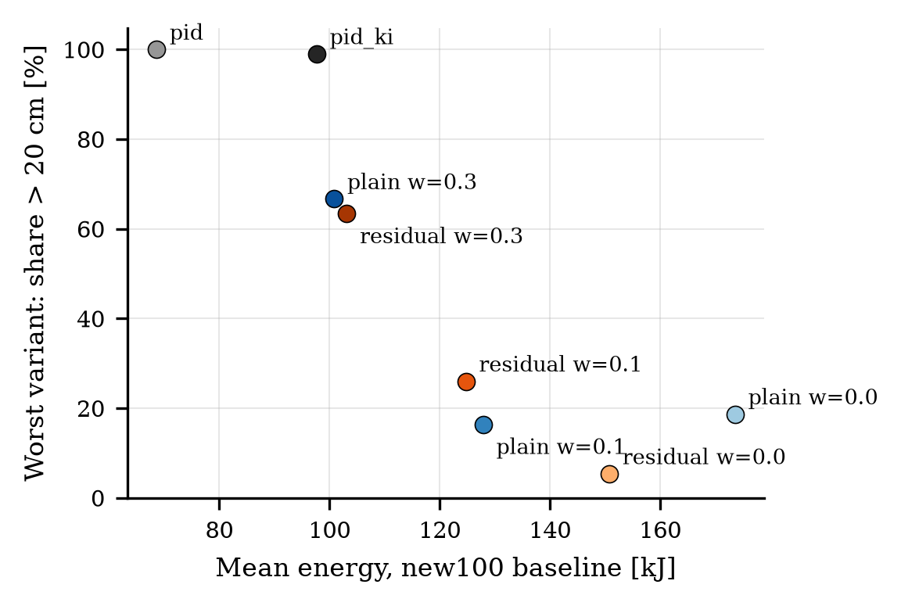
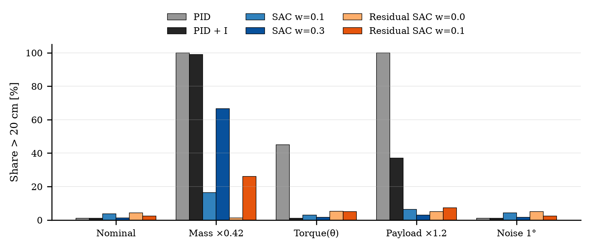

# DX300 boom RL study

> Energy vs accuracy trade-off for SAC control of a Doosan DX300 excavator boom, with PID baselines and a Simscape validation model.


[](LICENSE)


Soft Actor-Critic (SAC, stable-baselines3) control of the boom of a Doosan DX300 hydraulic excavator, studying the trade-off between positioning accuracy and actuator energy. The plant is a single boom joint in simulation. This repo is Stage 1 of the master's thesis "AI-Based Fault Detection and Energy Management of a Hydraulic Excavator Using a Digital Twin" (Okan University).

**Stage 1 result:** a tuned PID with gravity feed-forward uses the least energy on the nominal model (68.6 kJ, 1.0 % of moves over 20 cm), but misses 20 cm on 100 % of moves with Payload ×1.2. Domain-randomized SAC stays at 3.0–8.0 % under Payload ×1.2, at 100.8–173.6 kJ on the nominal model. SAC w=0.3 (100.8 kJ) is close to the energy of PID + I (97.7 kJ, 37 % misses under Payload ×1.2). Source: [paper/table1.md](paper/table1.md) and [rl/08b_eval_n10.csv](rl/08b_eval_n10.csv).

**Latest result (Lab 11, real plant, PID only):** on the plant built from the Lab 08a Simscape export (Lab 10), three PID operating points were picked from a Pareto front of energy vs move time: `fast` (Kp 5, Kd 2, 1.2 s), `balanced` (Kp 1.5, Kd 1, 1.5 s) and `economical` (Kp 0.8, Kd 0.8, 2.0 s). On the nominal plant `economical` is within 0.3 % of a computed energy floor (155.5 vs 154.9 kJ), so at slow moves there is almost nothing left for a learned controller; the gap is +5.1 % at 1.5 s and +10.4 % at 1.2 s, and larger under sensor noise. An adaptive mass-estimate filter fixes the Lab 10 `dump` failure: no row over 5 % misses on any of the three points (72 rows, 100 unseen scenarios). SAC has not yet been trained on this plant. Geometry and friction are ESTIMATED. Source: [rl/11_real_plant_tuning.md](rl/11_real_plant_tuning.md); Lab 10 plant and retune: [rl/10_real_plant.md](rl/10_real_plant.md).

## Repo layout

```
dx300sim/          DX300 parameters (dx300_params.py: boom length 6.245 m, pins, end stops) and boom geometry
rl/                RL code and results
  boom_env.py        1-DOF boom env (labs 02–07)
  boom_env_robust.py randomized boom env, power reward, substeps option (labs 08b–09)
  boom_env_real.py   boom env on the real plant from the Lab 08a Simscape export (labs 10–11, PID only so far)
  0N_*.py            numbered lab scripts, with their CSV / PNG / log results next to them
  models/, tb/       trained models and TensorBoard logs (gitignored)
paper/             Fig 1–3 (figs/) and Table 1 (table1.md, table1.tex), written by rl/09_paper_figures.py
matlab/lab08a/     Simscape Multibody + Fluids boom model, figures, parameter export (export/boom_params_lab08a.json)
matlab/lab09b2/    Simscape energy runs (plain and damped), exported to export/simscape_*.csv
ml/                early fault detection experiments (Isolation Forest, LSTM autoencoder)
docs/              acceptable error rationale (20 cm), env vs DX300 parameter audit, payload estimator, real plant design
tests/             pytest tests for the parameters and boom geometry
```

## Setup and reproduction

Run everything from the repo root.

```bash
python -m venv .venv
source .venv/bin/activate
pip install -r requirements.txt
pytest
```

Train (long runs; each 08b model takes about 12 min on the author's machine, see [rl/08b_train_log.csv](rl/08b_train_log.csv)):

```bash
python rl/04_knee_sweep.py        # 10 weights x 3 seeds, 20k steps
python rl/05_generalization.py    # w = 0, 0.1, 0.3, 0.5 x 3 seeds; saves the models used by 05b, 06, 06b
python rl/08b_robust_train.py     # 18 models: plain and residual SAC x w = 0, 0.1, 0.3 x 3 seeds, 100k steps
```

Evaluate:

```bash
python rl/05b_extrapolation.py
python rl/06_sensitivity.py
python rl/06b_noise.py
python rl/07_pid_baseline.py
python rl/08b_eval.py --substeps 10     # writes rl/08b_eval_n10.csv
python rl/08c_substep_check.py
python rl/08d_eval_simscape_J.py
```

Regenerate the paper figures and Table 1 (reads `rl/08b_eval_n10.csv`; Fig 3 needs the 08b models):

```bash
python rl/09_paper_figures.py
```

Simscape model (MATLAB):

```bash
matlab -batch "cd('matlab/lab08a'); stage4_run"
```

## Labs

Labs 03–09f are Stage 1 on the placeholder plant (`boom_env.py`, `boom_env_robust.py`); Labs 10–11 move to the real plant (`boom_env_real.py`). Unless noted: 3 seeds (0, 1, 2), 100 unseen scenarios (`new100`), "misses" = share of moves with tip error over 20 cm, energy = mean mechanical work per move. Tip error = 6.245 m × angle error (1° ≈ 10.9 cm).

| Lab | What | Key result |
|---|---|---|
| 03 | Energy-weight sweep, w ∈ {0, 0.05, 0.5, 2.0}, 20 scenarios | Accuracy vs energy trade-off ([rl/03_energy_sweep.png](rl/03_energy_sweep.png); plot only, no CSV). |
| 04 | Knee sweep, 10 weights from 0 to 2.0 | w=0.1 chosen as operating point: mean error 0.58° at 131.6 kJ vs 0.67° at 155.4 kJ for w=0 (−15 % energy). Mean error passes 2° between w=0.5 (1.69°) and w=0.75 (3.06°). |
| 05 | Generalization to `new100` | w=0.1: 0 % misses at 127.3 kJ; w=0: 1.3 % at 147.6 kJ. |
| 05b | Out-of-range targets (`out100`) | Policies fail outside the training range. w=0.1 worst error 4.78° (52 cm), 34 % misses. The 20 cm claim holds only inside the trained envelope. |
| 06 / 06b | Robustness of the 05 models | w=0.1 fails under Mass ×0.42 (91 % misses), Payload ×1.2 (48 %), angle-dependent torque limit Torque(θ) (17 %). It holds under sensor noise up to 1° (0.3 %) and Inertia ×0.38 (0 %). w=0 is more robust to mass (19 %), payload (2.3 %) and Torque(θ) (2.3 %), but not to Inertia ×0.38 (20 %, an integrator artifact, see 08c). |
| 07 | PID baselines with gravity feed-forward | PID matches SAC w=0.1 accuracy (mean 0.68° vs 0.63°, 1 % vs 0 % misses) at 68.5 vs 127.3 kJ. PID fails under Mass ×0.42 (100 %), Payload ×1.2 (100 %), Torque(θ) (44 %). PID + I: 98.3 kJ, fails under Mass ×0.42 (99 %) and Payload ×1.2 (37 %). |
| 08a | Simscape boom model (MATLAB) | Multibody + Fluids boom with front attachment masses, hydraulic cylinder, valve and relief. Validated vs analytic < 0.1 %, stall torque 0.24 %, boom-up 5.62 s, damping ζ sweep. Geometry estimated from a drawing; parameters exported to JSON. Used as the real plant in Labs 10–11 (PID only); SAC not yet trained on it. |
| 08b | Robust retrain: 18 models, plain + residual SAC (on top of the 07 PID), power reward, randomized mass / Torque(θ) / payload, full end-stop range | Plain SAC w=0.1 vs 06: payload misses 48 % → 6.3 %, Torque(θ) 17 % → 3.0 %, `out100` 34 % → 10.0 % (Residual SAC w=0.1: 7.3 %, 5.0 %, 0.0 %). Nominal energy 100.8–127.9 kJ for w=0.1/0.3 (150.8–173.6 kJ for w=0) vs 68.6 kJ for PID. SAC w=0.3 is close to PID + I energy (100.8 vs 97.7 kJ) with fewer payload misses (3.0 % vs 37 %). Mass ×0.42 remains the hardest case (Table 1). |
| 08c | Integrator check | The Inertia ×0.38 chattering is an explicit-Euler artifact: h·b/J = 0.05 × 6e5 / (0.38 × 8e4) ≈ 0.99 at one step per 0.05 s. 10 substeps fix it (Plain SAC w=0.1 misses 20.7 % → 4.0 %). All 08b–09 results use 10 substeps. |
| 08d | Eval at the 08a inertia with front attachment (J ≈ 262k kg m²) and 08a torque limit τ_up(θ) | Plain SAC w=0.1: 8.0 % misses at 209.5 kJ; Residual SAC w=0.1: 15.0 % at 190.6 kJ; PID: 100 %; PID + I: 72 %. Eval only, no retraining. |
| 09 | Paper figures | Fig 1 energy vs robustness, Fig 2 robustness per variant, Fig 3 payload trajectory, Table 1, in [paper/](paper/). 3 seeds, 10 integration substeps. |
| 09b | Hydraulic energy model and energy balance for the 07 PID | Baseline: E_pump 80.3 kJ vs E_mech 68.5 kJ; balance residual 0.3 % of E_pump. dp_valve = 20 bar and η_pump = 0.85 are assumed, not DX300 data ([rl/09b_energy_balance.csv](rl/09b_energy_balance.csv)). |
| 09b2 | Python energy model vs Simscape hydraulics | Boom-up agrees within 1.4 % only by cancellation; like for like Python is 13.8 % low (boom-up) and 54.9 % low (boom-down). No (dp_valve, η_pump) pair fits both moves ([rl/09b2_energy_check.md](rl/09b2_energy_check.md)). |
| 09c | Online payload estimator + payload-aware PID | Payload ×1.2 misses 100 % → 1 %, Mass ×0.42 100 % → 1 %, baseline unchanged (1 %, 68.5 kJ) ([rl/09c_comparison.md](rl/09c_comparison.md), derivation in [docs/09c_payload_estimator.md](docs/09c_payload_estimator.md)). |
| 09c2 | Stress test of the payload-aware PID | Breaks under the angle-dependent torque limit τ_d (44 % / 47 % baseline / payload) because the feed-forward uses the nominal limit; 1° sensor noise breaks it under payload (6 %); wrong J holds ([rl/09c2_stress.md](rl/09c2_stress.md)). |
| 09c3 | Feed-forward for the angle-dependent torque limit | Gain-scheduled variant (`sched`): τ_d alone 44 % → 2 % / 4 %, combined cases 43–51 % → 1–10 %; 15 ok, 14 degraded, 9 break over 38 rows ([rl/09c3_ff_torque_limit.md](rl/09c3_ff_torque_limit.md)). |
| 09d / 09e | Residual SAC on top of `sched` vs `sched` vs 08b SAC | Goal not met: `sched` + residual misses 20.7–34.7 % on combined rows vs 1–10 % for `sched` alone, at 1.02–1.09× its energy ([rl/09e_comparison.md](rl/09e_comparison.md)). |
| 09f | Kp retune of `sched` (no RL) | Kp 0.5 → 0.55 meets the goal: combined rows 1–3 % misses, E_mech 67.3–89.1 kJ (≤ 1.046× Kp=0.5), no single row worse. Tuned on the 20 original scenarios, checked on 100 unseen ([rl/09f_kp_retune.md](rl/09f_kp_retune.md)). |
| 10 | `sched` on the real plant (Lab 08a Simscape export), Simscape check, retune | Python vs Simscape holding torque within ~2 %. Retuned Kp 0.25, Kd 0.5 (Lab 07 criterion): 0–1 % misses on 36 matched rows vs 0–3 % on the placeholder, E_mech ≈ 2× (front attachment). Old gains overshoot (≈ 1/300 of the placeholder damping). Breaks on `dump` under combined noise ([rl/10_real_plant.md](rl/10_real_plant.md), [docs/10_real_plant.md](docs/10_real_plant.md)). |
| 11 | Energy floor, time-limited PID tuning and the `dump` failure on the real plant (no RL) | Pareto front of E_mech vs move time; three approved points: `fast` (Kp 5, Kd 2), `balanced` (Kp 1.5, Kd 1), `economical` (Kp 0.8, Kd 0.8). Nominal gap to the energy floor: +10.4 % at 1.2 s, +5.1 % at 1.5 s, +0.3 % at 2.0 s. Adaptive mass-estimate filter (`adapt_Tf1_c1_n2`): no row over 5 % misses on any point (72 rows); clamp and acceleration gate rejected (they break other rows). `fast` still oscillates on one low-inertia noisy row (+173 % above floor) ([rl/11_real_plant_tuning.md](rl/11_real_plant_tuning.md)). |

### Table 1

Controllers from 08b and the 07 PIDs, 10 substeps ([rl/08b_eval_n10.csv](rl/08b_eval_n10.csv)). The first five columns use the nominal model on `new100`.

| Controller | Mean [cm] | Worst [cm] | Energy [kJ] | > 20 cm [%] | out100 > 20 cm [%] | Worst variant > 20 cm [%] |
|---|---:|---:|---:|---:|---:|---|
| SAC w=0.0 | 7.0 | 39.8 | 173.6 | 7.7 | 9.7 | 18.7 (Mass ×0.42) |
| SAC w=0.1 | 5.5 | 40.0 | 127.9 | 3.7 | 10.0 | 16.3 (Mass ×0.42) |
| SAC w=0.3 | 6.1 | 55.2 | 100.8 | 1.3 | 7.3 | 66.7 (Mass ×0.42) |
| Residual SAC w=0.0 | 4.9 | 29.1 | 150.8 | 4.3 | 18.0 | 5.3 (Torque(θ)) |
| Residual SAC w=0.1 | 5.2 | 23.0 | 124.7 | 2.3 | 0.0 | 26.0 (Mass ×0.42) |
| Residual SAC w=0.3 | 6.4 | 26.1 | 103.1 | 1.7 | 9.7 | 63.3 (Mass ×0.42) |
| PID | 7.1 | 21.4 | 68.6 | 1.0 | 18.0 | 100.0 (Mass ×0.42) |
| PID + I | 8.5 | 21.6 | 97.7 | 1.0 | 14.0 | 99.0 (Mass ×0.42) |

Seeds: mean of means, worst of maxima, mean of shares.



*Fig 1: mean energy on the nominal model vs the worst-variant share of moves over 20 cm.*



*Fig 2: share of moves over 20 cm per variant on `new100`.*

## Method

- **Environment:** [rl/boom_env.py](rl/boom_env.py), a 1-DOF boom (gravity, viscous damping, end stops at −47.2° and 60.4°). One episode is 200 steps of 0.05 s. The action is a normalised torque command in [−1, 1].
- **Robust env (08b):** [rl/boom_env_robust.py](rl/boom_env_robust.py) covers the full end-stop range and randomizes mass, the Torque(θ) limit and a payload step per episode. The observation adds the error integral; the reward uses mechanical power instead of u². Residual SAC adds its action to the 07 PID command.
- **Reward (01–05):** `-(err² + 0.01·ω² + w·u²)`.
- **Energy:** mechanical work at the boom joint, `Σ |τ·ω|·dt`. Pump, valve and cylinder losses are not modelled.
- **Evaluation:** deterministic policy; `new100` (RNG seed 123) and `out100` (RNG seed 321), plus the 06/06b model variants.

## Limitations

- **Single boom joint.** Arm, bucket and swing are not modelled. Torque is applied directly at the joint; the RL env has no hydraulic model.
- **SAC results are on the placeholder plant.** [rl/boom_env.py](rl/boom_env.py) and [rl/boom_env_robust.py](rl/boom_env_robust.py), used for all SAC training (Labs 02–09), still use placeholder values ([docs/param_audit.md](docs/param_audit.md)). Their gravity term uses the boom mass only; in the 08a model the front attachment is 71–88 % of the gravity torque and ≈ 88 % of J. The real plant [rl/boom_env_real.py](rl/boom_env_real.py) (Labs 10–11) uses the 08a parameters, but only PID controllers have been run on it so far (08d swaps only J and the torque limit for SAC). Its geometry and friction are estimated from a drawing.
- **Energy.** SAC uses more energy than the nominal PID (100.8–173.6 vs 68.6 kJ). Its advantage is robustness, not efficiency.
- **Trained range only.** Results hold inside the trained range. Outside it (05b), errors reach 52 cm.
- **Tolerance.** The 20 cm tip tolerance is a design assumption, not a published standard ([docs/acceptable_error.md](docs/acceptable_error.md)).

## Roadmap

- **Next:** train and evaluate SAC on the real plant (`boom_env_real.py`) against the three Lab 11 PID points, targeting the remaining gaps (fast moves and sensor noise).
- **Stage 2:** arm, bucket and swing; pump and valve; engine and fuel map; RL for the full attachment; validation with quarry data.
- **Stage 3:** digging and breaker loads; energy recovery.
- **Stage 4:** hydraulic fault detection and a fault-aware controller.

## Citation

Paper under preparation (target: ICEEE 2027). Citation will be added on publication. Until then, cite the repository via [CITATION.cff](CITATION.cff) (GitHub's "Cite this repository" button).

## Author

Ahmed Ayyad, Automotive Mechatronics M.Sc. (thesis track), Istanbul Okan University.

## License

[MIT](LICENSE)
