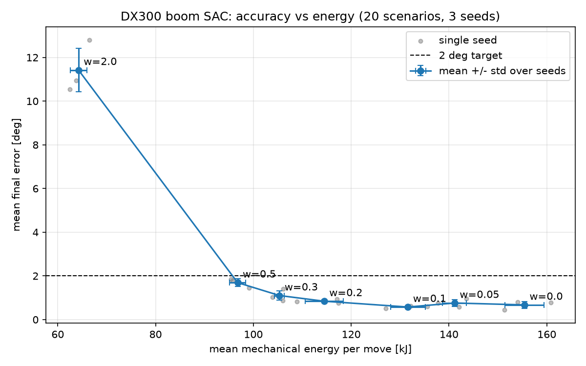

# DX300 boom RL study

RL (SAC, stable-baselines3) controller for the Doosan DX300 excavator boom, studying the trade-off between positioning accuracy and actuator energy.

## Key result

**A small energy weight (w = 0.1) cuts boom energy by 14% (127 vs 148 kJ) and also removes worst-case misses: 0% of moves over 20 cm at the boom tip vs 1.3% for w = 0, on 100 unseen scenarios, 3 seeds.**

Results on the 100 unseen scenarios (`new100` rows of [rl/05_generalization.csv](rl/05_generalization.csv)). Mean, p95, energy and % over 20 cm are averaged over the 3 seeds; max is the worst move over all seeds.

| w   | mean (cm) | p95 (cm) | max (cm) | energy (kJ) | moves > 20 cm |
|-----|----------:|---------:|---------:|------------:|--------------:|
| 0.0 |       7.4 |     14.0 |     25.7 |       147.6 |          1.3% |
| 0.1 |       6.9 |     13.6 |     17.2 |       127.3 |          0.0% |
| 0.3 |      10.8 |     24.3 |     31.7 |       103.7 |          9.7% |
| 0.5 |      16.1 |     36.7 |     47.2 |        95.5 |         26.7% |



## Method

- **Environment:** [rl/boom_env.py](rl/boom_env.py), a 1-DOF boom model (gravity, viscous damping, mechanical end stops at -47.2° and 60.4°). One episode is 200 steps of 0.05 s (10 s). The action is a normalised torque command in [-1, 1].
- **Reward:** `-(err² + 0.01·ω² + w·u²)`, where `err` is the angle error (rad), `ω` the boom angular velocity and `u` the command. The energy weight w penalises squared command effort, a proxy for energy; energy itself is not in the reward.
- **Energy (reported):** mechanical work at the boom joint, `Σ |τ·ω|·dt`, in kJ per move. This is not hydraulic energy: pump, valve and cylinder losses are not modelled.
- **Training:** SAC (stable-baselines3, `MlpPolicy`), 20k steps per run, 3 seeds (0, 1, 2) per energy weight.
- **Evaluation:** deterministic policy on 20 fixed scenarios (RNG seed 7, used for the knee sweep) and 100 unseen scenarios (RNG seed 123, same start/target ranges).
- **Tip error:** boom length L = 6.245 m from [dx300sim/dx300_params.py](dx300sim/dx300_params.py); tip error = L × angle error in radians, so 1° ≈ 10.9 cm.

## Scope and limitations

- Boom joint only. Arm, bucket and swing are not modelled.
- Simulation only. Torque is applied directly at the joint; there is no hydraulic model. The environment parameters (inertia, mass, damping, torque limit) are rough placeholders, not measured DX300 values.
- Coarse positioning (lifting to a truck, moving into position before a dig), not fine grading.
- The 20 cm tip tolerance is a design assumption, not a published standard. See [docs/acceptable_error.md](docs/acceptable_error.md).

## Repo layout

- `dx300sim/`: DX300 boom parameters and geometry (single source of truth for dimensions).
- `rl/`: boom environment and numbered RL scripts (`01_` to `05_`), with their CSV and PNG results.
- `ml/`: fault detection experiments (Isolation Forest, LSTM autoencoder).
- `tests/`: pytest tests for the parameters and boom geometry.
- `docs/`: design notes, including the acceptable error rationale.

## How to run

Run everything from the repo root.

```bash
python -m venv .venv
source .venv/bin/activate
pip install -r requirements.txt
python rl/04_knee_sweep.py
python rl/05_generalization.py
pytest
```

Both RL scripts are resumable: `04` skips (w, seed) pairs already in its CSV, and `05` loads models already saved in `rl/models/`. Trained models (`rl/models/`) and TensorBoard logs (`rl/tb/`) are gitignored.
