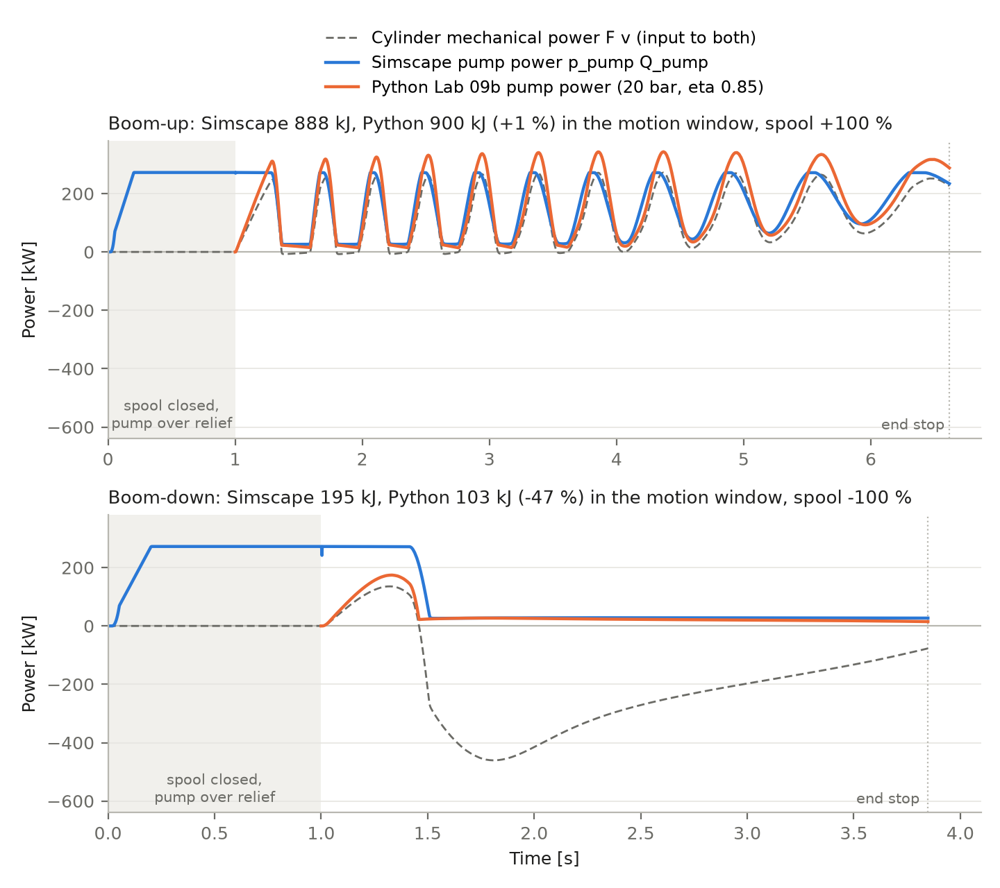
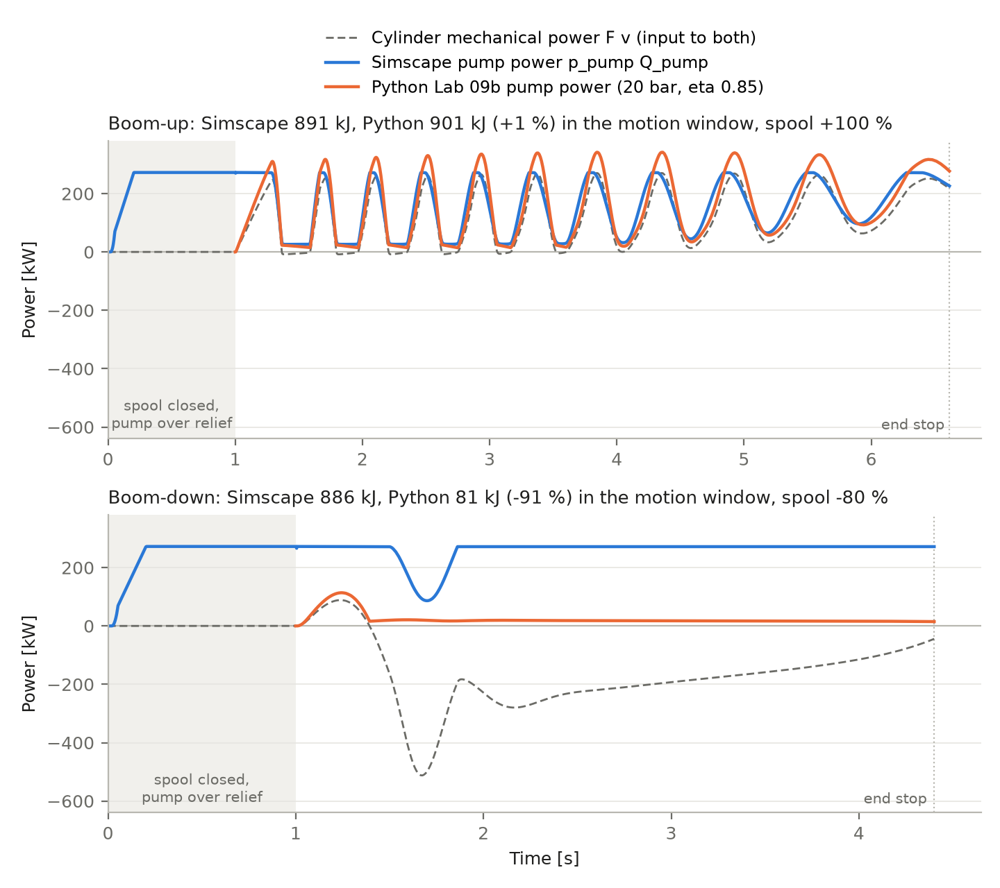

# Lab 09b2: Python energy model vs Simscape hydraulics

**Result.** On these two moves the Lab 09b Python model gives E_pump = 900.3 kJ against 887.9 kJ in Simscape for boom-up (+12.5 kJ, +1.4 %) and 103.5 kJ against 194.8 kJ for boom-down (-91.3 kJ, -46.9 %). The boom-up agreement is a cancellation, not a match: the Python pump-loss term (135.1 kJ, absent in Simscape) happens to offset the relief flow and the larger valve drop of Simscape. Compared like for like (hydraulic energy, no pump efficiency) Python is 13.8 % low on boom-up and 54.9 % low on boom-down. No physical (dp_valve, eta_pump) pair fits both moves.

**Rerun (section 6).** The lab08a damped model with a boom-down metered at 80 % spool gives the same boom-up (Simscape 891.1 kJ, Python 901.5 kJ, +1.2 %) and a far larger boom-down gap: Simscape 886.4 kJ, Python 81.1 kJ (-90.9 %). The damped model still oscillates, and a spool ramp does not remove it, so lab08a has no clean boom-up reference.

All numbers are from `rl/09b2_energy_check.csv` and `matlab/lab09b2/export/simscape_energy.csv`. Reproduce with:

```
matlab -batch "run('matlab/lab09b2/lab09b2_run.m')"
matlab -batch "src_model_09b2='dx300_boom_hyd_damped'; tag_09b2='_damped'; spool_frac_down=0.80; run('matlab/lab09b2/lab09b2_run.m')"
matlab -batch "run('matlab/lab09b2/lab09b2_explore.m')"
python rl/09b2_energy_check.py
```

Line 1 is the first run (sections 1 to 5), line 2 the rerun (section 6), line 3 the sweep behind the rerun choices (about 10 minutes).

## Setup

| item | value | status |
|---|---|---|
| Simscape model | `matlab/lab09b2/dx300_boom_hyd_09b2.slx`, a copy of `matlab/lab08a/dx300_boom_hyd.slx` with pump-flow logging and a move selector (`lab09b2_build.m`). `matlab/lab08a/` is untouched (49 files, md5 identical before and after). | |
| Boom-up | from th_min = -47.2 deg, spool step to +dS_max at t = 1 s, as `stage4_run.m` | th_min ESTIMATED |
| Boom-down | from th_max = 60.4 deg, cap side at holding pressure (188.6 bar), spool step to -dS_max at t = 1 s | th_max ESTIMATED |
| Pump | ideal flow source, 494 L/min, constant | OFFICIAL flow; constant delivery is a property of the lab08a model |
| Relief | 330 bar | OFFICIAL |
| Bore, rod, stroke | 140 mm, 95 mm, 1450 mm, 2 cylinders | OFFICIAL |
| Valve area, spool stroke, oil, dead volumes | A_valve_max 3e-4 m^2, dS_max 5 mm, 870 kg/m^3, 1.5e9 Pa, 1 L | ESTIMATED (lab08a InitFcn) |
| Python model | `rl/lab09_common.py`, dp_valve = 20 bar, eta_pump = 0.85 | ASSUMED - not from manual |

Window for every energy below: spool opening (t = 1 s) to first arrival within 0.2 deg of the end stop, as in `stage4_run.m`. The end-stop impact after arrival is excluded. Pressures are gauge. Simscape integrals use the solver steps (trapz); the Python formula runs on the same logs resampled to 1 ms (pump energy from the 1 ms export: 887.99 vs 887.86 kJ up, 194.93 vs 194.78 kJ down).

Logged per move in `matlab/lab09b2/export/simscape_{up,down}.csv`: theta, omega, tau, F, v, p_cap, p_rod, p_pump, Q_pump, Q_relief, Q_cap, Q_rod, spool position.

## 1. Simscape energy split [kJ]

| move | time s | pump output | relief | supply-valve drop | into cylinder | out of cylinder | net cylinder | joint work (signed) | net cylinder - joint |
|---|---:|---:|---:|---:|---:|---:|---:|---:|---:|
| up | 5.62 | 887.9 | 48.4 | 140.9 | 698.6 | 25.6 | 673.1 | 672.3 | 0.74 |
| down | 2.85 | 194.8 | 60.6 | 71.8 | 62.4 | 639.0 | -576.5 | -573.2 | -3.35 |

- pump output = integral of p_pump x Q_pump. "into cylinder" = pressure x flow of the pump-fed chamber (cap side for up, rod side for down). "out of cylinder" = pressure x flow of the chamber that drains to tank, all of it dissipated in the return orifice.
- pump output = relief + supply-valve drop + into cylinder. The supply-valve figure is the remainder, so it includes the small storage in the 2 L pump-line volume.
- joint work is the integral of tau x omega; the integral of F x v gives the same 672.3 and -573.2 kJ.
- net cylinder - joint work is 0.74 and -3.35 kJ: oil compressibility. The model has no cylinder friction and no leakage.
- Boom-down: the 639.0 kJ leaving the cap side is the potential energy of the boom, throttled to tank.
- Outside the window: in the 1 s before the spool opens the pump is dead-headed over the relief and delivers 243.5 kJ per move.

## 2. Comparison, per move

Python inputs are the Simscape-logged F and v.

| move | quantity | Simscape kJ | Python kJ | diff kJ | diff % |
|---|---|---:|---:|---:|---:|
| up | E_mech = sum abs(F v) dt | 679.8 | 679.8 | -0.0 | -0.00 |
| up | E_pump (Python shaft input vs Simscape hydraulic output) | 887.9 | 900.3 | +12.5 | +1.4 |
| up | E_hyd = E_pump x eta_pump (like for like) | 887.9 | 765.3 | -122.6 | -13.8 |
| down | E_mech = sum abs(F v) dt | 652.7 | 652.7 | -0.0 | -0.00 |
| down | E_pump (Python shaft input vs Simscape hydraulic output) | 194.8 | 103.5 | -91.3 | -46.9 |
| down | E_hyd = E_pump x eta_pump (like for like) | 194.8 | 87.9 | -106.8 | -54.9 |

E_mech agrees because both sides integrate the same F and v; it checks the export and the bookkeeping, not the model. The Simscape pump has no efficiency, so its energy is hydraulic output, while the Python E_pump is shaft input. The E_hyd rows remove that mismatch.



## 3. Where the difference comes from

Simscape minus Python, kJ. The first three columns are in Simscape and not in Python; the last two are in Python and not in Simscape.

| move | relief flow | supply-valve drop | cylinder inlet energy above W_pos | Python valve term (20 bar x volume) | Python pump-loss term (1 - eta) | sum = Simscape - Python |
|---|---:|---:|---:|---:|---:|---:|
| up | +48.4 | +140.9 | +22.6 | -89.2 | -135.1 | -12.5 |
| down | +60.6 | +71.8 | +22.6 | -48.1 | -15.5 | +91.3 |

**Pump type.** The Simscape pump delivers 494 L/min at all times. The pressure is whatever the circuit needs to pass that flow, and what the cylinder does not take leaves over the relief at 330 bar. The Python pump delivers exactly the cylinder flow A x v at p_load + dp_valve, with no flow limit and no pressure limit. On the logged moves the Python formula asks for more than 494 L/min in 47 % of the boom-up window and 63 % of the boom-down window (peak 698 L/min), and for more than 330 bar in 4 % of each (peak 350.8 bar). The cylinder can outrun the pump in Simscape only because the supplied chamber decompresses and cavitates.

**Relief flow.** 48.4 kJ (up) and 60.6 kJ (down) inside the window, with the relief open about 15 % of the time, mainly in the first 0.3 to 0.45 s while the boom accelerates and the pump still delivers full flow. Expressed on the swept volume this is 10.8 bar (up) and 25.2 bar (down). Python has no relief term. The 243.5 kJ of standby before the spool opens is also absent in Python.

**Valve loss.** The Simscape supply orifice costs 140.9 kJ (up) and 71.8 kJ (down), equal to 31.6 and 29.8 bar on the swept volume, against the ASSUMED 20 bar. The orifice law gives rho / 2 x (Q / (Cd A))^2 = 32 bar at 494 L/min for the open area of 1.5e-4 m^2, so the Simscape drop grows with flow squared and is not a constant margin. The figure is only as good as the ESTIMATED valve area. On boom-up the return orifice adds 25.6 kJ of back pressure (5.7 bar), inside the "cylinder inlet energy above W_pos" column.

**Pump efficiency.** Python divides by 0.85, which adds 135.1 kJ (up) and 15.5 kJ (down). Simscape has nothing to compare it with.

**Quality of the two Simscape moves.** Both are full-spool steps on the undamped lab08a model, and neither is a clean reference:
- Boom-up runs as a limit cycle. The cap pressure swings between the relief setting and about zero roughly ten times during the stroke (figure, top), and is below -0.5 bar gauge for 4.5 % of the window. This is the hydraulic resonance treated in lab08a Stage 5. Section 6 repeats the move on `dx300_boom_hyd_damped.slx`.
- Boom-down overruns. After 0.45 s the boom falls faster than 494 L/min can fill the rod side (peak 0.69 m/s, needing 688 L/min), and the rod side sits at -0.98 bar gauge for 81 % of the window. The pump then pushes into a void at about 33 bar. The model has no counterbalance, regeneration or separate meter-out, so the boom-down pump energy is a low-confidence number, and the rod-side volume flow in that phase is computed at cavitated density. Section 6 repeats the move with a smaller opening that does not cavitate.

## 4. Which dp_valve and eta_pump would match

The Python model gives E_pump = (W_pos + dp_valve x V) / eta_pump. Setting this equal to the Simscape pump energy:

| move | W_pos kJ | swept volume V, L | dp_valve at eta 0.85 | dp_valve at eta 1.00 |
|---|---:|---:|---:|---:|
| up | 676.0 | 44.62 | 17.6 bar | 47.5 bar |
| down | 39.8 | 24.07 | 52.3 bar | 64.4 bar |

One pair for both moves:

| fit | dp_valve bar | eta_pump | up: Python kJ (error) | down: Python kJ (error) |
|---|---:|---:|---|---|
| Lab 09b values (ASSUMED) | 20.0 | 0.850 | 900.3 (+1.4 %) | 103.5 (-46.9 %) |
| exact, both moves | 76.0 | 1.143 | 887.9 (+0.0 %) | 194.8 (+0.0 %) |
| least squares, eta fixed 1.00 | 51.3 | 1.000 | 904.9 (+1.9 %) | 163.2 (-16.2 %) |
| least squares, eta fixed 0.85 | 25.4 | 0.850 | 928.8 (+4.6 %) | 118.8 (-39.0 %) |

The only pair that matches both moves needs eta_pump = 1.143, which is not physical. With eta_pump = 1.00, the value consistent with the ideal Simscape pump, boom-up needs 47.5 bar and boom-down 64.4 bar, so one constant does not fit both. These fitted pressures are not valve losses: 10.8 bar (up) and 25.2 bar (down) of them are relief flow, which depends on how the move starts, not on the valve.

## 5. Statement

The Python energy model does not match the Simscape hydraulic model. It reproduces the mechanical work exactly, and on boom-up its pump energy lands within 1.4 % only because two unrelated terms cancel. On boom-down it is 47 % low. The gap is structural (constant-flow pump with relief against a demand-following pump with no limits), so retuning dp_valve and eta_pump on these runs would hide it, not fix it.

What should change:
1. Keep dp_valve = 20 bar and eta_pump = 0.85 as ASSUMED. Do not replace them with the fitted values above; those absorb relief flow and rest on an ESTIMATED valve area.
2. In the write-up, describe the Python E_pump as the energy of an ideal demand-following pump, a lower bound, and the Simscape figure as a constant-flow pump with relief, an upper bound. Which is closer to the DX300 depends on the real pump control, to be taken from the shop manual. Not verified here.
3. Add the two limits the Python model lacks, both from OFFICIAL data: pump flow 494 L/min (rod speed at most 0.267 m/s extending, 0.496 m/s retracting) and pressure 330 bar. At least count and report violations per episode.
4. If the valve loss is refined, make it flow dependent (dp proportional to Q^2) instead of a constant.
5. Do not treat the lab08a hydraulic model as an energy reference yet. Section 6 shows why: the damped model still oscillates on boom-up, and a boom-down without cavitation runs the pump against the relief for 89 % of the move.

## 6. Rerun: damped model and metered boom-down

Model: `matlab/lab09b2/dx300_boom_hyd_09b2_damped.slx`, a copy of `matlab/lab08a/dx300_boom_hyd_damped.slx` (cylinder friction 1.9 kN + 2.5 kN s/m, ESTIMATED, lab08a Stage 5). Boom-up: spool step to +100 %, as before. Boom-down: spool step to -80 %, an open area of 90 mm^2 against 150 mm^2 at full command. The opening is a design choice of this lab (ASSUMED), not DX300 data.

### How the two settings were chosen

Sweep on the damped model (`matlab/lab09b2/lab09b2_explore.log`). The Simscape log data limit (default: last 5000 points) is switched off in the copies; with it on, runs longer than the first two lose the start of the move.

| move | spool | ramp s | time s | p_cap min / max bar | p_rod min bar | rod side below -0.5 bar | p_cap swing bar | relief open | E_pump kJ | relief kJ |
|---|---:|---:|---:|---:|---:|---:|---:|---:|---:|---:|
| up | 100 % | step | 5.61 | -0.8 / 330.8 | 0.00 | 0 % | 168.2 | 15 % | 890.9 | 48.5 |
| up | 100 % | 1.0 | 6.16 | -0.7 / 315.3 | 0.00 | 0 % | 166.4 | 23 % | 1047.0 | 197.0 |
| up | 100 % | 2.0 | 6.70 | 0.4 / 303.9 | 0.00 | 0 % | 154.9 | 28 % | 1222.1 | 351.9 |
| up | 100 % | 4.0 | 7.91 | -0.5 / 296.0 | -0.02 | 0 % | 145.8 | 37 % | 1606.0 | 671.7 |
| down | 100 % | step | 2.86 | 3.4 / 215.7 | -0.99 | 81 % | 41.9 | 15 % | 197.0 | 62.6 |
| down | 90 % | step | 3.19 | 5.9 / 251.3 | -0.95 | 41 % | 42.8 | 14 % | 389.9 | 64.6 |
| down | 85 % | step | 3.20 | 8.3 / 284.8 | -0.83 | 11 % | 51.6 | 26 % | 635.1 | 72.2 |
| down | 80 % | step | 3.41 | 12.7 / 334.7 | 0.00 | 0 % | 51.8 | 89 % | 888.4 | 134.1 |
| down | 75 % | step | 3.98 | 20.7 / 381.6 | 0.00 | 0 % | 66.3 | 100 % | 1081.0 | 288.7 |
| down | 70 % | step | 4.89 | 35.3 / 389.7 | 0.00 | 0 % | 52.9 | 100 % | 1330.4 | 537.9 |

"p_cap swing" is half the peak-to-peak of the cap pressure after removing a 1 s moving mean, the Stage 5 measure. The sweep copy carries a 1 ms rate limiter in the "step" rows, so its numbers differ slightly from the run below (888.4 vs 886.4 kJ at 80 %).

- **Boom-up stays a limit cycle.** Friction-only damping leaves the swing at 168 bar (undamped: the same pattern; Stage 5 stored 164.8 against 165.6 bar). A spool ramp of 1 to 4 s lowers it only to 146 bar and costs 197 to 672 kJ of relief flow, because the constant-flow pump dumps over the relief while the spool is partly open. Boom-up was therefore kept as a step.
- **Boom-down: 80 % is the largest tested opening without cavitation.** At 85 % the rod side is still below -0.5 bar for 11 % of the move.
- **Not run:** the Stage 5 viscous case zeta = 0.20 (1.69e6 N s/m, ESTIMATED), the only lab08a setting that damps the resonance (Stage 5: swing 28.3 bar). It is an artificial damper on the rod, so its dissipation would enter the pump energy.

### Simscape energy split [kJ]

| move | time s | pump output | relief | supply-valve drop | into cylinder | out of cylinder | net cylinder | joint work (signed) | net cylinder - joint |
|---|---:|---:|---:|---:|---:|---:|---:|---:|---:|
| up | 5.62 | 891.1 | 48.3 | 140.8 | 702.0 | 25.6 | 676.5 | 672.7 | 3.78 |
| down, 80 % | 3.40 | 886.4 | 132.1 | 178.9 | 575.3 | 1137.9 | -562.6 | -573.0 | 10.42 |

"net cylinder - joint" now includes the cylinder friction. Boom-up is within 3.4 kJ of the undamped run in every column.

Boom-down at 80 % does not cavitate (rod side minimum 0.00 bar gauge), but the price is high. To keep the rod side filled against the meter-out orifice the pump sits at the relief for 89 % of the move (mean pump pressure 316.5 bar, mean rod pressure 245.3 bar). It puts 575.3 kJ into the rod side, and the cap side throttles 1137.9 kJ to tank: the 573.0 kJ of boom potential energy plus what the pump pushed in. This follows from one spool edge metering both sides with a constant-flow pump. The model has no regeneration and no separate meter-out.

### Comparison

| move | quantity | Simscape kJ | Python kJ | diff kJ | diff % |
|---|---|---:|---:|---:|---:|
| up | E_mech = sum abs(F v) dt | 681.1 | 681.2 | +0.1 | +0.02 |
| up | E_pump (Python shaft input vs Simscape hydraulic output) | 891.1 | 901.5 | +10.4 | +1.2 |
| up | E_hyd = E_pump x eta_pump (like for like) | 891.1 | 766.3 | -124.8 | -14.0 |
| down, 80 % | E_mech = sum abs(F v) dt | 614.5 | 614.5 | -0.0 | -0.01 |
| down, 80 % | E_pump (Python shaft input vs Simscape hydraulic output) | 886.4 | 81.1 | -805.3 | -90.9 |
| down, 80 % | E_hyd = E_pump x eta_pump (like for like) | 886.4 | 68.9 | -817.5 | -92.2 |



Where the difference comes from, Simscape minus Python, kJ:

| move | relief flow | supply-valve drop | cylinder inlet energy above W_pos | Python valve term | Python pump-loss term | sum = Simscape - Python |
|---|---:|---:|---:|---:|---:|---:|
| up | +48.3 | +140.8 | +25.0 | -89.3 | -135.2 | -10.4 |
| down, 80 % | +132.1 | +178.9 | +554.5 | -48.1 | -12.2 | +805.3 |

The boom-down gap is dominated by the 554.5 kJ the pump pushes into the rod side beyond the positive work. The Python model charges nothing for lowering except dp_valve x volume, because it sets p_pump = max(p_load, 0) + dp_valve and p_load is negative under an overrunning load.

### Fit

| move | W_pos kJ | swept volume V, L | dp_valve at eta 0.85 | dp_valve at eta 1.00 |
|---|---:|---:|---:|---:|
| up | 677.0 | 44.63 | 18.0 bar | 48.0 bar |
| down, 80 % | 20.8 | 24.06 | 304.5 bar | 359.8 bar |

The exact pair for these two moves is eta_pump = -0.847 and dp_valve = -320.8 bar, which has no meaning. One pair for all four moves, error of the Python E_pump per move:

| fit | dp_valve bar | eta_pump | first run, up | first run, down | damped, up | damped, down 80 % |
|---|---:|---:|---:|---:|---:|---:|
| Lab 09b values (ASSUMED) | 20.0 | 0.85 | +1.4 % | -46.9 % | +1.2 % | -90.9 % |
| least squares, eta fixed 1.00 | 84.7 | 1.00 | +18.7 % | +25.1 % | +18.4 % | -74.7 % |
| least squares, eta fixed 0.85 | 54.0 | 0.85 | +21.5 % | +2.5 % | +21.2 % | -80.0 % |

### Statement after the rerun

- **Boom-up result holds.** Friction changes the numbers by a few kJ, so the +1.2 % agreement is the same cancellation as before.
- **Boom-down depends on the spool opening, not on the load.** Simscape pump energy runs from 197 kJ at 100 % to 1330 kJ at 70 % for the same lowering, while the Python model gives 103.5 kJ at 100 % and 81.1 kJ at 80 %. No constant dp_valve can follow that.
- **The statement in section 5 stands and is stronger.** The Python model and the lab08a Simscape model describe different hydraulic systems on boom-down. Which one is closer to the DX300 needs the real boom-lowering circuit (regeneration, meter-out, pump control) from the shop manual. Not verified here.

## Side findings in lab08a (not changed)

- The lab08a pressure sensors already output gauge pressure: logged p_rod is 2.4 Pa at t = 0.5 s and logged p_cap(0) is 9470511 Pa against p0_cap = 9571836 Pa absolute. `stage4_run.m` subtracts 101325 Pa again, so its printed pressures are about 1 bar low.
- A spool command of dS_max opens the valve orifices to 1.5e-4 m^2, half of A_valve_max = 3e-4 m^2 (Simscape log: `orifice_PA.orifice_area` max 0.00015). The block's spool-travel offset (7.5 mm) was left at its default while the opening stroke was set to 5 mm.
