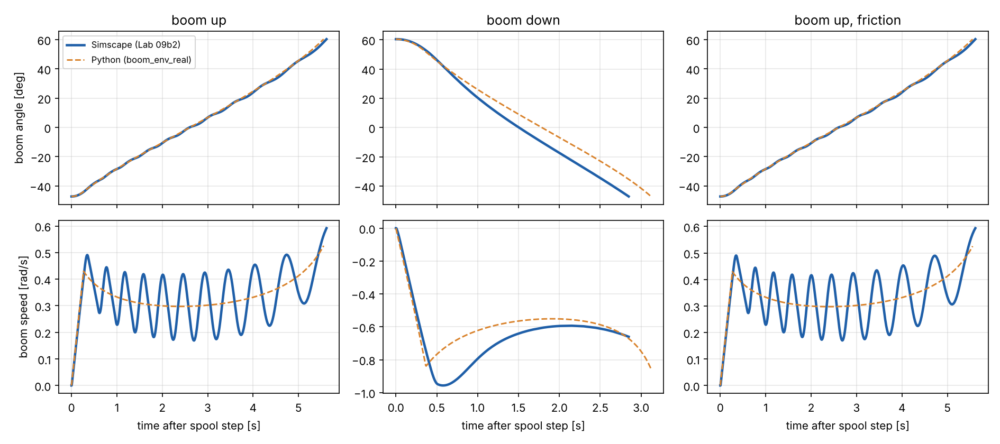

# Lab 10c: dynamic check of the real plant against Simscape

Generated by `rl/10c_dynamic_check.py`. No training, nothing tuned. Full-command moves
of the Lab 09b2 Simscape model (spool step at t = 0) against `rl/boom_env_real.py`
(u = +-1, dt = 0.005 s, one substep). Window: spool step until within 0.2 deg of the end
stop. All values ESTIMATED.

| move | arrival Python s | arrival Simscape s | diff % | RMS angle diff deg | max angle diff deg | RMS speed diff rad/s | peak speed Python rad/s | peak speed Simscape rad/s |
|---|---:|---:|---:|---:|---:|---:|---:|---:|
| up | 5.552 | 5.618 | -1.17 | 0.74 | 2.23 | 0.0790 | 0.526 | 0.592 |
| down | 3.119 | 2.848 | +9.52 | 8.20 | 11.76 | 0.1118 | 0.855 | 0.957 |
| up, friction | 5.553 | 5.615 | -1.11 | 0.74 | 2.18 | 0.0784 | 0.525 | 0.594 |

## Reading

- **Boom-up** (with and without friction): the mean motion matches. Simscape oscillates
  around the Python speed at about 2 Hz, most likely the oil column (compressibility),
  which the rigid, flow-limited Python plant does not model.
- **Boom-down**: Python is slower. Simscape retracts at up to 0.690 m/s rod speed
  against the Python retraction limit of 0.496 m/s (pump flow / annulus area).
  The Simscape rod side drops to -0.99 bar (gauge, about vacuum) and fills at
  up to 779 L/min against 494 L/min pump flow, so in Simscape gravity pulls the
  boom down faster than the pump refills the rod side. Python caps the speed at the pump
  flow. A real DX300 boom-down regeneration or anti-cavitation circuit would decide which
  is closer; that is not modelled in either. Lowering moves of Labs 10-12 are therefore
  conservative (slower) whenever they hit the retraction limit.

Not covered: `simscape_down_damped.csv` (spool -80 %, no counterpart in the torque
command u); partial commands; valve dynamics.
