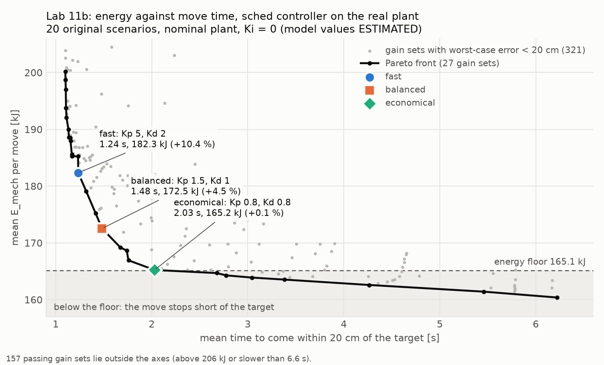

# Lab 11: energy floor, time-limited tuning and the dump failure on the real plant

No RL and no training. Plant: `rl/boom_env_real.py` (Lab 10a, unchanged). Controller: `sched` of `rl/10_sched_real.py` (unchanged); `Sched11` in `rl/11_real_plant_tuning.py` adds estimator options and equals `sched` bit for bit with the options off (`--step check`: largest difference 0.0 on the 45 gain sets of `rl/10_tuning_grid.csv` and on 72 noisy rows; the two Lab 10 controllers rerun here reproduce all 144 rows of `rl/10_real_plant.csv` exactly). All numbers below come from `rl/11_real_plant_tuning.csv`, `rl/11_floor_moves.csv`, `rl/11_gain_grid.csv`, `rl/11_pareto_front.csv`, `rl/11_dump_diagnosis.csv`, `rl/11_dump_fix_tuning.csv`, `rl/11_dump_fix_checks.csv`, `rl/11_points.json` and `rl/11_dump_fix_choice.json`; this file is built from them by `rl/11_report.py`.

## Status of the values

- **OFFICIAL**: pump flow 494 L/min, relief 330 bar, cylinder bore and rod, boom mass and length (6.245 m, `dx300sim/dx300_params.py`), bucket mass 1120 kg (Lab 10: model unverified).
- **ESTIMATED**: pins, moment arm, torque limits, inertia, front point masses, friction (1.9 kN, 2.5 kN s/m), full tip mass 3406 kg (Lab 08a). **Every result in this report (E_mech, floor, time, miss rate, m_hat) is a model output and therefore ESTIMATED.** Nothing here is measured on a machine.
- **ASSUMED**: all gains and grids, the 20 cm bound, the 10 s move, the payload variants and their step at 5 s, the noise levels, the selection rule of 11b and its two thresholds, every estimator parameter of 11c, the number of noise seeds.
- **E_pump**: lower bound, ASSUMED parameters (dp_valve = 20 bar, eta_pump = 0.85, `rl/09b_hyd_params.py`, not from manual).

## Use of the unseen scenarios

- Tuning set: the 20 original scenarios (RNG seed 7). Every choice was made on it: the Pareto front, the three operating points, the diagnosis of 11c and every estimator parameter of 11c.
- The 100 unseen scenarios (RNG seed 123) were run once, after `rl/11_points.json` was approved and `rl/11_dump_fix_choice.json` was written. The script refuses to load them before the approval.
- **I looked at unseen results before choosing, in one respect:** `rl/10_real_plant.md` was read at the start. It holds the Lab 10 unseen results of Kp 0.25 / Kd 0.5 and Kp 0.55 / Kd 0.25, including which dump rows break. That knowledge motivated 11c and is why the dump variant with 1.0 deg noise was the diagnosis case. No Lab 11 choice uses an unseen number: the selection rule and the 11c ranking read tuning-set files only.
- The 11c sweep ran in three passes, all on the tuning set and all before the unseen run. Pass 1 put the best detector factor (c = 2) and the best gate (0.5) on the edge of the grid; pass 2 added c = 0.5, 1, 1.5 and gates 1, 2; that put the best adaptive T_f (1 s) on the edge, so pass 3 added adaptive T_f = 0.5 s. The final choices are inside the grid.

## 1. Energy floor (11a)

### 1.1 Definition

Floor = least mechanical work of a move from the start angle to the target with no overshoot (monotone, rest to rest). E_mech of the plant is the sum of |tau_cyl omega| h.

```
raise:  floor = dPE(m_tip) + F_c ds
lower:  floor = |dPE(m_tip)| - (F_c + c_v v_ret_max) ds
dPE = integral of |tau_g(theta, m_tip)| dtheta      ds = integral of r(theta) dtheta (rod travel)
```

- tau_g > 0 over the whole range (checked at import; 378.7 kN m at theta = 0 with 3406 kg, ESTIMATED), so the integral of |tau_g| is the change of potential energy.
- m_tip is the tip mass of the variant at the start of the move. The mass step comes at 5 s; on the tuning set the three operating points are within 20 cm of the target by then on every move (slowest move 4.20 s).
- **Friction sign.** The task said "plus friction work". That holds for a raise. On a lowering move the cylinder absorbs |dPE| minus what friction dissipates, so friction lowers E_mech. Adding it would put the floor above a perfect move. The floor uses minus, with viscous friction at the retraction speed limit (0.496 m/s), the largest help friction can give. The friction term is under 1 % of the floor on each of the 20 moves of 1.2.
- The floor does not depend on the move time as long as gravity alone can start the lowering move and stop the raise (1.45 rad/s^2 at theta = 0 with 3406 kg, ESTIMATED). Below that time the cylinder has to push or brake and the true minimum is above this floor. **The minimum-energy move for a given move time was not computed**, so at the fast end the gap to the floor is an upper bound of what a better controller can gain.

Split of E_mech per 0.05 s control step, by the angle the step covers:

- **direct**: first pass over the angle between start and target.
- **overshoot**: first outward and first return pass over the angle beyond the target.
- **oscillation**: every repeat pass, and travel behind the start.

`E_mech - floor = overshoot + oscillation + direct excess - shortfall` (asserted on every move). **Direct excess** = direct work minus the floor of the angle really covered: reverse-torque braking, powered lowering, viscous friction, kinetic energy carried past the target. **Shortfall** = floor of the angle between the furthest point reached and the target: work saved by not finishing the move. The task asked for two terms; the other two are needed to close the balance. A reversal inside one control step is attributed by net travel.

### 1.2 Floor of every move, 20 original scenarios, baseline (3406 kg)

All values ESTIMATED. Cells: E_mech kJ (percent above the floor).

| move | start deg | target deg | gravity kJ | friction kJ | floor kJ | L10_tuned (Kp 0.25, Kd 0.5) | L10_old (Kp 0.55, Kd 0.25) | fast (Kp 5, Kd 2) | balanced (Kp 1.5, Kd 1) | economical (Kp 0.8, Kd 0.8) |
|---:|---:|---:|---:|---:|---:|---:|---:|---:|---:|---:|
| 1 | 23.6 | 44.5 | 138.5 | +0.51 | 139.0 | 136.6 (-2 %) | 219.1 (+58 %) | 139.6 (+0 %) | 139.9 (+1 %) | 138.7 (-0 %) |
| 2 | 34.9 | -1.7 | 249.7 | -1.68 | 248.0 | 245.6 (-1 %) | 450.3 (+82 %) | 305.4 (+23 %) | 274.1 (+11 %) | 248.4 (+0 %) |
| 3 | -0.6 | 42.9 | 294.2 | +1.17 | 295.3 | 292.8 (-1 %) | 369.4 (+25 %) | 296.1 (+0 %) | 296.4 (+0 %) | 295.5 (+0 %) |
| 4 | -22.5 | 39.3 | 403.2 | +1.73 | 404.9 | 402.1 (-1 %) | 486.4 (+20 %) | 405.9 (+0 %) | 406.3 (+0 %) | 405.2 (+0 %) |
| 5 | 36.5 | 15.0 | 146.9 | -0.94 | 146.0 | 143.3 (-2 %) | 263.0 (+80 %) | 190.0 (+30 %) | 149.3 (+2 %) | 145.5 (-0 %) |
| 6 | -0.3 | 2.0 | 15.3 | +0.07 | 15.3 | 12.5 (-19 %) | 22.3 (+45 %) | 15.3 (-0 %) | 15.2 (-1 %) | 14.7 (-4 %) |
| 7 | -3.9 | 13.4 | 116.9 | +0.51 | 117.4 | 114.5 (-2 %) | 218.3 (+86 %) | 118.0 (+1 %) | 120.4 (+3 %) | 117.1 (-0 %) |
| 8 | 14.7 | 20.9 | 43.1 | +0.17 | 43.3 | 40.4 (-7 %) | 67.8 (+57 %) | 43.4 (+0 %) | 43.3 (+0 %) | 42.6 (-2 %) |
| 9 | 51.2 | 37.3 | 86.5 | -0.50 | 86.0 | 83.7 (-3 %) | 151.7 (+76 %) | 101.0 (+17 %) | 86.5 (+1 %) | 85.5 (-1 %) |
| 10 | 23.4 | 50.8 | 178.0 | +0.65 | 178.7 | 176.4 (-1 %) | 256.7 (+44 %) | 179.4 (+0 %) | 179.4 (+0 %) | 178.5 (-0 %) |
| 11 | -6.9 | -6.2 | 4.5 | +0.02 | 4.5 | 1.9 (-59 %) | 4.5 (+0 %) | 4.5 (-1 %) | 4.2 (-6 %) | 3.8 (-14 %) |
| 12 | 22.7 | -14.2 | 244.6 | -1.77 | 242.9 | 241.0 (-1 %) | 448.4 (+85 %) | 292.5 (+20 %) | 270.3 (+11 %) | 244.3 (+1 %) |
| 13 | -20.3 | 18.2 | 248.0 | +1.13 | 249.2 | 246.3 (-1 %) | 359.0 (+44 %) | 249.9 (+0 %) | 252.3 (+1 %) | 249.3 (+0 %) |
| 14 | 11.8 | 45.9 | 229.0 | +0.87 | 229.9 | 227.5 (-1 %) | 305.1 (+33 %) | 230.6 (+0 %) | 230.8 (+0 %) | 229.9 (-0 %) |
| 15 | 23.9 | 18.2 | 40.2 | -0.26 | 39.9 | 37.2 (-7 %) | 67.8 (+70 %) | 40.1 (+0 %) | 40.1 (+1 %) | 39.3 (-1 %) |
| 16 | 14.1 | -0.2 | 97.0 | -0.69 | 96.3 | 93.7 (-3 %) | 178.5 (+85 %) | 113.0 (+17 %) | 98.5 (+2 %) | 96.1 (-0 %) |
| 17 | -22.0 | -4.0 | 107.3 | +0.53 | 107.8 | 105.2 (-2 %) | 233.6 (+117 %) | 108.7 (+1 %) | 112.5 (+4 %) | 108.1 (+0 %) |
| 18 | 28.6 | -3.4 | 218.7 | -1.50 | 217.2 | 214.8 (-1 %) | 414.1 (+91 %) | 269.3 (+24 %) | 233.5 (+8 %) | 217.2 (+0 %) |
| 19 | 4.6 | -16.9 | 135.8 | -1.05 | 134.7 | 132.9 (-1 %) | 271.4 (+102 %) | 177.5 (+32 %) | 141.1 (+5 %) | 135.4 (+1 %) |
| 20 | 38.9 | -6.6 | 307.6 | -2.08 | 305.5 | 303.3 (-1 %) | 496.5 (+63 %) | 366.5 (+20 %) | 356.4 (+17 %) | 309.4 (+1 %) |
| mean |  |  | 165.2 | -0.16 | 165.1 | 162.6 (-1.5 %) | 264.2 (+60.0 %) | 182.3 (+10.4 %) | 172.5 (+4.5 %) | 165.2 (+0.1 %) |

### 1.3 Split of the excess, 20 original scenarios, nominal plant

Mean over the 20 moves, kJ, all ESTIMATED. Payload variants (step at 5 s): `baseline` 3406 kg; `fill_half` 2263 -> 3406 kg; `fill` 1120 -> 3406 kg; `dump` 3406 -> 1120 kg.

| controller | variant | floor | E_mech | above floor % | excess | overshoot | oscillation | direct excess | shortfall | reach 20 cm s |
|---|---|---:|---:|---:|---:|---:|---:|---:|---:|---:|
| L10_tuned (Kp 0.25, Kd 0.5) | baseline | 165.1 | 162.6 | -1.5 | -2.5 | 0.0 | 0.0 | +0.2 | -2.7 | 4.27 |
| L10_tuned (Kp 0.25, Kd 0.5) | fill_half | 133.3 | 143.0 | +7.3 | +9.7 | 4.0 | 5.3 | +1.8 | -1.4 | 4.53 |
| L10_tuned (Kp 0.25, Kd 0.5) | fill | 101.5 | 133.1 | +31.1 | +31.6 | 13.4 | 16.7 | +2.7 | -1.3 | 4.34 |
| L10_tuned (Kp 0.25, Kd 0.5) | dump | 165.1 | 174.9 | +5.9 | +9.8 | 7.4 | 7.4 | -2.9 | -2.1 | 4.40 |
| L10_old (Kp 0.55, Kd 0.25) | baseline | 165.1 | 264.2 | +60.0 | +99.1 | 75.5 | 26.5 | -2.9 | +0.0 | 1.49 |
| L10_old (Kp 0.55, Kd 0.25) | fill_half | 133.3 | 228.7 | +71.6 | +95.4 | 58.7 | 38.4 | -1.6 | +0.0 | 1.47 |
| L10_old (Kp 0.55, Kd 0.25) | fill | 101.5 | 206.0 | +103.0 | +104.5 | 45.5 | 59.7 | -0.7 | +0.0 | 1.49 |
| L10_old (Kp 0.55, Kd 0.25) | dump | 165.1 | 275.0 | +66.6 | +109.9 | 78.0 | 34.8 | -2.9 | +0.0 | 1.49 |
| fast (Kp 5, Kd 2) | baseline | 165.1 | 182.3 | +10.4 | +17.2 | 0.3 | 0.0 | +16.9 | -0.0 | 1.24 |
| fast (Kp 5, Kd 2) | fill_half | 133.3 | 152.7 | +14.6 | +19.4 | 1.8 | 2.6 | +15.0 | +0.0 | 1.24 |
| fast (Kp 5, Kd 2) | fill | 101.5 | 122.5 | +20.8 | +21.1 | 3.6 | 5.0 | +12.5 | +0.0 | 1.25 |
| fast (Kp 5, Kd 2) | dump | 165.1 | 186.6 | +13.0 | +21.5 | 2.7 | 1.9 | +16.9 | -0.0 | 1.24 |
| balanced (Kp 1.5, Kd 1) | baseline | 165.1 | 172.5 | +4.5 | +7.4 | 2.6 | 0.0 | +4.8 | -0.0 | 1.48 |
| balanced (Kp 1.5, Kd 1) | fill_half | 133.3 | 147.8 | +10.9 | +14.6 | 4.6 | 6.0 | +4.1 | +0.0 | 1.51 |
| balanced (Kp 1.5, Kd 1) | fill | 101.5 | 124.0 | +22.2 | +22.5 | 8.2 | 11.1 | +3.2 | +0.0 | 1.54 |
| balanced (Kp 1.5, Kd 1) | dump | 165.1 | 181.9 | +10.2 | +16.8 | 7.6 | 4.3 | +4.8 | +0.0 | 1.48 |
| economical (Kp 0.8, Kd 0.8) | baseline | 165.1 | 165.2 | +0.1 | +0.1 | 0.1 | 0.0 | +0.4 | -0.4 | 2.03 |
| economical (Kp 0.8, Kd 0.8) | fill_half | 133.3 | 144.0 | +8.0 | +10.7 | 4.7 | 5.6 | +0.5 | -0.1 | 2.05 |
| economical (Kp 0.8, Kd 0.8) | fill | 101.5 | 124.5 | +22.7 | +23.1 | 10.4 | 12.2 | +0.5 | -0.0 | 2.06 |
| economical (Kp 0.8, Kd 0.8) | dump | 165.1 | 177.6 | +7.6 | +12.5 | 6.8 | 5.5 | +0.4 | -0.1 | 2.03 |

### 1.4 Split of the excess, 100 unseen scenarios, no stress (`none`)

Mean over the 100 moves, kJ, all ESTIMATED. Lab 10 estimator.

| controller | variant | floor | E_mech | above floor % | excess | overshoot | oscillation | direct excess | shortfall | reach 20 cm s |
|---|---|---:|---:|---:|---:|---:|---:|---:|---:|---:|
| L10_tuned (Kp 0.25, Kd 0.5) | baseline | 154.9 | 153.2 | -1.2 | -1.8 | 0.0 | 0.7 | +0.2 | -2.7 | 4.11 |
| L10_tuned (Kp 0.25, Kd 0.5) | fill_half | 125.1 | 135.6 | +8.4 | +10.5 | 3.7 | 6.7 | +1.7 | -1.6 | 4.24 |
| L10_tuned (Kp 0.25, Kd 0.5) | fill | 95.2 | 128.4 | +34.9 | +33.2 | 13.0 | 18.9 | +2.6 | -1.3 | 4.16 |
| L10_tuned (Kp 0.25, Kd 0.5) | dump | 154.9 | 166.5 | +7.4 | +11.5 | 8.1 | 8.3 | -2.8 | -2.0 | 4.40 |
| L10_old (Kp 0.55, Kd 0.25) | baseline | 154.9 | 243.0 | +56.8 | +88.0 | 67.7 | 22.4 | -2.1 | -0.0 | 1.49 |
| L10_old (Kp 0.55, Kd 0.25) | fill_half | 125.1 | 213.4 | +70.7 | +88.4 | 53.1 | 36.4 | -1.2 | -0.0 | 1.47 |
| L10_old (Kp 0.55, Kd 0.25) | fill | 95.2 | 197.9 | +107.8 | +102.7 | 43.3 | 59.8 | -0.4 | -0.0 | 1.47 |
| L10_old (Kp 0.55, Kd 0.25) | dump | 154.9 | 257.0 | +65.9 | +102.1 | 70.1 | 34.1 | -2.1 | +0.0 | 1.49 |
| fast (Kp 5, Kd 2) | baseline | 154.9 | 171.0 | +10.4 | +16.1 | 0.2 | 0.0 | +15.8 | -0.0 | 1.18 |
| fast (Kp 5, Kd 2) | fill_half | 125.1 | 143.6 | +14.8 | +18.6 | 1.8 | 2.6 | +14.1 | -0.0 | 1.19 |
| fast (Kp 5, Kd 2) | fill | 95.2 | 115.9 | +21.8 | +20.7 | 3.7 | 5.2 | +11.9 | -0.0 | 1.19 |
| fast (Kp 5, Kd 2) | dump | 154.9 | 175.4 | +13.2 | +20.5 | 2.7 | 1.9 | +15.8 | -0.0 | 1.18 |
| balanced (Kp 1.5, Kd 1) | baseline | 154.9 | 162.8 | +5.1 | +7.8 | 2.3 | 0.1 | +5.5 | -0.0 | 1.45 |
| balanced (Kp 1.5, Kd 1) | fill_half | 125.1 | 140.2 | +12.1 | +15.2 | 4.5 | 6.0 | +4.7 | -0.0 | 1.46 |
| balanced (Kp 1.5, Kd 1) | fill | 95.2 | 118.7 | +24.7 | +23.5 | 8.3 | 11.5 | +3.7 | -0.0 | 1.48 |
| balanced (Kp 1.5, Kd 1) | dump | 154.9 | 172.5 | +11.4 | +17.6 | 7.5 | 4.6 | +5.5 | -0.0 | 1.45 |
| economical (Kp 0.8, Kd 0.8) | baseline | 154.9 | 155.5 | +0.3 | +0.5 | 0.1 | 0.2 | +0.7 | -0.4 | 1.97 |
| economical (Kp 0.8, Kd 0.8) | fill_half | 125.1 | 136.3 | +8.9 | +11.2 | 4.6 | 6.0 | +0.7 | -0.1 | 1.97 |
| economical (Kp 0.8, Kd 0.8) | fill | 95.2 | 119.3 | +25.3 | +24.1 | 10.3 | 13.1 | +0.6 | -0.0 | 1.97 |
| economical (Kp 0.8, Kd 0.8) | dump | 154.9 | 168.3 | +8.6 | +13.4 | 7.1 | 5.9 | +0.6 | -0.2 | 1.97 |

Percent above the floor over all 72 rows of Lab 10 (18 conditions x 4 variants), unseen, ESTIMATED:

| controller | above floor %: lowest row | highest row | mean | overshoot kJ (mean) | oscillation kJ (mean) | direct excess kJ (mean) | shortfall kJ (mean) |
|---|---:|---:|---:|---:|---:|---:|---:|
| L10_tuned (Kp 0.25, Kd 0.5) | -1.2 | +59.3 | +16.7 | 7.7 | 12.1 | +0.5 | -1.3 |
| L10_old (Kp 0.55, Kd 0.25) | +39.8 | +158.5 | +90.9 | 67.7 | 49.9 | -1.2 | -0.0 |
| fast (Kp 5, Kd 2) | +5.6 | +318.1 | +61.7 | 8.4 | 51.9 | +17.0 | -0.0 |
| balanced (Kp 1.5, Kd 1) | +3.7 | +87.8 | +27.2 | 10.0 | 18.5 | +5.8 | -0.0 |
| economical (Kp 0.8, Kd 0.8) | +0.3 | +71.0 | +19.7 | 8.1 | 14.8 | +1.1 | -0.1 |

Findings (20 original scenarios, baseline, ESTIMATED):

- **The Lab 10 tuned gains are below the floor** (-1.5 %). Overshoot and oscillation are 0.0 and 0.0 kJ; the saving is shortfall (-2.7 kJ): the move stops short of the target. The Lab 07 rule (lowest energy with no miss) rewarded an unfinished move.
- The Lab 10 old gains are +60.0 % above the floor: 75.5 kJ overshoot and 26.5 kJ oscillation of 99.1 kJ excess.
- `economical` sits on the floor (+0.1 %) at 2.03 s. `balanced` is +4.5 % above at 1.48 s, `fast` +10.4 % at 1.24 s.
- The excess of `fast` is direct excess (+16.9 of +17.2 kJ), not overshoot (0.3 kJ). It sits on the lowering moves: +0 to +32 % above the floor on the 9 lowering moves, -1 to +1 % on the 11 raising moves. The cylinder pushes the boom down: its positive work on the 9 lowering moves is 19.4 kJ per move for `fast`, 7.5 kJ for `balanced` and 0.3 kJ for `economical`; a lowering move driven by gravity needs none. The push is paid twice, once to give it and once to absorb it.
- On the `fill` variants the excess is overshoot and oscillation after the mass step at 5 s: the boom sags until the estimate has followed, then comes back.

## 2. Time-limited tuning (11b)

Grid: 24 Kp values from 0.25 to 50 times 20 Kd values from 0.12 to 10 (ASSUMED; the Lab 07 values plus 1-1.2-1.5-2-2.5-3-4-5-6-8 steps per decade), Ki = 0, nominal plant, `baseline`, the 20 original scenarios. 321 of 480 gain sets have a worst-case error under 20 cm; 27 of them are on the Pareto front of mean E_mech against mean time to come within 20 cm.



Pareto front, all values ESTIMATED. Noise columns: the same 20 scenarios with 1.0 deg sensor noise (tuning set, used for information only).

| # | Kp | Kd | reach 20 cm s (mean) | (max) | E_mech kJ | above floor % | E_pump kJ (lower bound, ASSUMED parameters) | worst error cm | peak overshoot cm | flow limit % | noise: E_mech kJ | noise: worst miss % (4 variants) | point |
|---:|---:|---:|---:|---:|---:|---:|---:|---:|---:|---:|---:|---:|---|
| 1 | 40 | 6 | 1.10 | 3.40 | 200.2 | +21.3 | 148.0 | 0.0 | 67.0 | 8.6 | 529.5 | 0 |  |
| 2 | 25 | 4 | 1.10 | 3.40 | 198.7 | +20.4 | 147.2 | 0.0 | 67.0 | 8.6 | 443.6 | 0 |  |
| 3 | 30 | 5 | 1.10 | 3.45 | 197.0 | +19.3 | 145.9 | 0.0 | 67.0 | 8.5 | 468.1 | 0 |  |
| 4 | 15 | 3 | 1.11 | 3.45 | 193.8 | +17.4 | 143.9 | 0.0 | 58.0 | 8.2 | 353.8 | 0 |  |
| 5 | 20 | 4 | 1.11 | 3.45 | 192.1 | +16.3 | 142.6 | 0.0 | 58.6 | 8.2 | 388.3 | 0 |  |
| 6 | 10 | 2.5 | 1.13 | 3.45 | 190.0 | +15.1 | 141.3 | 0.0 | 27.4 | 7.7 | 305.7 | 0 |  |
| 7 | 12 | 3 | 1.14 | 3.45 | 188.6 | +14.3 | 140.3 | 0.1 | 27.6 | 7.7 | 317.7 | 0 |  |
| 8 | 20 | 5 | 1.15 | 3.45 | 188.5 | +14.2 | 140.1 | 0.0 | 24.5 | 7.8 | 373.4 | 0 |  |
| 9 | 15 | 4 | 1.16 | 3.45 | 187.9 | +13.8 | 139.7 | 0.1 | 17.9 | 7.6 | 334.9 | 0 |  |
| 10 | 10 | 3 | 1.17 | 3.50 | 185.6 | +12.4 | 138.2 | 0.1 | 4.9 | 7.4 | 296.5 | 0 |  |
| 11 | 8 | 2.5 | 1.17 | 3.50 | 185.3 | +12.2 | 138.0 | 0.1 | 2.9 | 7.2 | 284.4 | 0 |  |
| 12 | 12 | 4 | 1.23 | 3.55 | 185.2 | +12.2 | 138.0 | 0.1 | 0.0 | 7.1 | 305.5 | 0 |  |
| 13 | 5 | 2 | 1.24 | 3.55 | 182.3 | +10.4 | 136.2 | 0.2 | 1.0 | 6.6 | 255.9 | 0 | **fast** |
| 14 | 3 | 1.5 | 1.32 | 3.65 | 179.1 | +8.5 | 134.3 | 0.2 | 2.5 | 5.7 | 241.7 | 0 |  |
| 15 | 2 | 1.2 | 1.42 | 3.70 | 175.2 | +6.1 | 132.0 | 0.4 | 4.1 | 5.0 | 232.3 | 0 |  |
| 16 | 1.5 | 1 | 1.48 | 3.75 | 172.5 | +4.5 | 130.5 | 0.5 | 7.5 | 4.3 | 221.1 | 0 | **balanced** |
| 17 | 1 | 0.8 | 1.67 | 3.90 | 169.2 | +2.5 | 128.5 | 0.9 | 9.8 | 3.2 | 211.9 | 0 |  |
| 18 | 1.5 | 1.2 | 1.74 | 4.05 | 168.6 | +2.1 | 127.8 | 0.7 | 0.0 | 3.5 | 213.2 | 0 |  |
| 19 | 1.2 | 1 | 1.76 | 4.00 | 166.9 | +1.1 | 126.7 | 0.8 | 1.0 | 3.2 | 209.6 | 0 |  |
| 20 | 0.8 | 0.8 | 2.03 | 4.20 | 165.2 | +0.1 | 125.6 | 1.2 | 1.6 | 2.6 | 202.7 | 0 | **economical** |
| 21 | 0.8 | 1 | 2.68 | 4.95 | 164.7 | -0.2 | 125.3 | 1.5 | 0.0 | 2.1 | 197.6 | 0 |  |
| 22 | 0.6 | 0.8 | 2.78 | 5.00 | 164.3 | -0.5 | 125.0 | 2.0 | 0.0 | 1.8 | 194.8 | 0 |  |
| 23 | 0.4 | 0.6 | 3.04 | 5.20 | 163.9 | -0.7 | 124.6 | 2.8 | 0.0 | 1.4 | 191.5 | 0 |  |
| 24 | 0.3 | 0.5 | 3.38 | 5.40 | 163.5 | -0.9 | 124.2 | 3.6 | 0.0 | 0.9 | 188.1 | 0 |  |
| 25 | 0.25 | 0.5 | 4.27 | 6.55 | 162.6 | -1.5 | 123.5 | 5.6 | 0.0 | 0.7 | 183.1 | 5 | Lab 10 tuned |
| 26 | 0.25 | 0.6 | 5.46 | 8.30 | 161.4 | -2.2 | 122.5 | 11.0 | 0.0 | 0.5 | 178.6 | 15 |  |
| 27 | 0.3 | 0.8 | 6.22 | 9.40 | 160.4 | -2.9 | 121.7 | 16.4 | 0.0 | 0.4 | 176.8 | 10 |  |

Selection rule (tuning set only; thresholds ASSUMED):

1. Admissible = front points with mean E_mech at or above the mean floor and peak overshoot under 20 cm. 12 points are left. The front points below the floor save energy only by stopping short (section 1); the fastest front points overshoot by up to 67 cm before they settle.
2. `economical` = lowest E_mech admissible.
3. `fast` = lowest E_mech within 0.10 s (two control steps) of the fastest admissible.
4. `balanced` = admissible point between them that is closest to (time of `fast`, energy of `economical`), axes scaled by the span between the two.

**Approved operating points** (user approval in chat, 2026-11-12, after the front was shown):

| point | Kp | Ki | Kd | reach 20 cm s | E_mech kJ | above floor % | E_pump kJ (lower bound, ASSUMED parameters) | worst error cm |
|---|---:|---:|---:|---:|---:|---:|---:|---:|
| fast | 5 | 0 | 2 | 1.24 | 182.3 | +10.4 | 136.2 | 0.2 |
| balanced | 1.5 | 0 | 1 | 1.48 | 172.5 | +4.5 | 130.5 | 0.5 |
| economical | 0.8 | 0 | 0.8 | 2.03 | 165.2 | +0.1 | 125.6 | 1.2 |

Front points on the edge of the grid: Kp 0.25 / Kd 0.5, Kp 0.25 / Kd 0.6. They are at the slow end, below the floor, and not admissible; the three points are inside the grid.

## 3. The three points on the 100 unseen scenarios, all 72 rows of Lab 10

Lab 10 estimator (T_f = 0.2 s, m_hat limited to 0-6812 kg), 10 s per move, all values ESTIMATED. Status: BREAKS if miss rate > 5 %, degraded if > 1 %, else ok. The two Lab 10 controllers are rerun for reference.

| controller | miss % | E_mech kJ | above floor % | E_pump kJ (lower bound, ASSUMED parameters) | reach 20 cm s | flow limit % | status over 72 rows |
|---|---:|---:|---:|---:|---:|---:|---|
| fast (Kp 5, Kd 2) | 0 | 115.9-534.6 | 5.6-318.1 | 96.4-421.8 | 1.16-1.27 | 6.0-7.5 | 0 break, 0 degraded, 72 ok |
| balanced (Kp 1.5, Kd 1) | 0-6 | 115.4-235.3 | 3.7-87.8 | 97.3-187.3 | 1.37-1.59 | 4.4-5.5 | 1 break, 0 degraded, 71 ok |
| economical (Kp 0.8, Kd 0.8) | 0-19 | 117.2-215.8 | 0.3-71.0 | 98.2-173.0 | 1.82-2.37 | 2.8-3.9 | 1 break, 0 degraded, 71 ok |
| L10_tuned (Kp 0.25, Kd 0.5) | 0-80 | 125.3-193.1 | -1.2-59.3 | 100.6-159.2 | 3.88-4.45 | 0.4-1.1 | 4 break, 0 degraded, 68 ok |
| L10_old (Kp 0.55, Kd 0.25) | 0-13 | 177.4-349.6 | 39.8-158.5 | 144.8-260.6 | 1.43-1.54 | 4.1-6.8 | 1 break, 10 degraded, 61 ok |

- Rows over 5 % miss, fast (Kp 5, Kd 2): none.
- Rows over 5 % miss, balanced (Kp 1.5, Kd 1): all_n1.0_J0.38_b0.5 dump (6 %).
- Rows over 5 % miss, economical (Kp 0.8, Kd 0.8): all_n1.0_J0.38_b0.5 dump (19 %).
- Rows over 5 % miss, L10_tuned (Kp 0.25, Kd 0.5): noise_1.0 dump (11 %); all_n1.0_J0.38_b0.5 dump (80 %); all_n1.0_J1.5_b0.5 dump (10 %); all_n1.0_J1.5_b2.0 dump (10 %).
- Rows over 5 % miss, L10_old (Kp 0.55, Kd 0.25): all_n1.0_J0.38_b0.5 dump (13 %).
- **The miss rate hides an instability of `fast`.** Rows with E_mech more than 100 % above the floor (threshold ASSUMED): `fast`: J_x0.38 fill (+291 %), J_x0.38 dump (+245 %), all_n0.2_J0.38_b0.5 fill (+305 %), all_n0.2_J0.38_b0.5 dump (+222 %), all_n0.5_J0.38_b0.5 fill (+318 %), all_n0.5_J0.38_b0.5 dump (+220 %), all_n1.0_J0.38_b0.5 fill_half (+119 %), all_n1.0_J0.38_b0.5 fill (+312 %), all_n1.0_J0.38_b0.5 dump (+204 %); `balanced`: none; `economical`: none. (The Lab 10 old gains have 27 such rows, from overshoot; the Lab 10 tuned gains 0.) On `J_x0.38` with a light bucket (`fill` before 5 s, `dump` after) `fast` oscillates without any sensor noise: 535 kJ on `J_x0.38` `dump`, of which 355 kJ oscillation, m_hat / m_tip spread 2.86, 0 % misses. `J_x0.38` `baseline` is quiet (164 kJ), and with the adaptive filter of 11c the `dump` row costs 172 kJ. So it takes low inertia, a light bucket and the 0.2 s estimate together (the estimator uses J_nom). The tuning grid ran on the nominal plant and could not see it.
- 330 bar could not hold the flow limit in 0 substeps over all rows of `rl/11_real_plant_tuning.csv`.

Columns per point: f = fast, b = balanced, e = economical. Miss % = share of moves with final tip error over 20 cm. m_hat / m_tip = estimate over true tip mass in the last 2 s.

| condition | variant | floor kJ | miss %: f | miss %: b | miss %: e | E_mech kJ: f | E_mech kJ: b | E_mech kJ: e | above floor %: f | above floor %: b | above floor %: e | E_pump kJ (lower bound, ASSUMED parameters): f | E_pump kJ (lower bound, ASSUMED parameters): b | E_pump kJ (lower bound, ASSUMED parameters): e | reach s: f | reach s: b | reach s: e | m_hat / m_tip (e) | status f / b / e |
|---|---|---:|---:|---:|---:|---:|---:|---:|---:|---:|---:|---:|---:|---:|---:|---:|---:|---|---|
| none | baseline | 154.9 | 0 | 0 | 0 | 171.0 | 162.8 | 155.5 | +10.4 | +5.1 | +0.3 | 131.7 | 126.9 | 122.1 | 1.18 | 1.45 | 1.97 | 1.000 ± 0.003 | ok / ok / ok |
| none | fill_half | 125.1 | 0 | 0 | 0 | 143.6 | 140.2 | 136.3 | +14.8 | +12.1 | +8.9 | 114.2 | 112.7 | 109.9 | 1.19 | 1.46 | 1.97 | 1.000 ± 0.001 | ok / ok / ok |
| none | fill | 95.2 | 0 | 0 | 0 | 115.9 | 118.7 | 119.3 | +21.8 | +24.7 | +25.3 | 96.6 | 99.4 | 99.7 | 1.19 | 1.48 | 1.97 | 1.000 ± 0.001 | ok / ok / ok |
| none | dump | 154.9 | 0 | 0 | 0 | 175.4 | 172.5 | 168.3 | +13.2 | +11.4 | +8.6 | 135.2 | 134.8 | 132.6 | 1.18 | 1.45 | 1.97 | 0.995 ± 0.003 | ok / ok / ok |
| noise_0.2 | baseline | 154.9 | 0 | 0 | 0 | 184.2 | 170.4 | 161.3 | +18.9 | +10.0 | +4.1 | 141.2 | 132.3 | 126.3 | 1.19 | 1.44 | 1.97 | 1.000 ± 0.035 | ok / ok / ok |
| noise_0.2 | fill_half | 125.1 | 0 | 0 | 0 | 154.3 | 145.3 | 139.7 | +23.3 | +16.1 | +11.7 | 122.0 | 116.5 | 112.8 | 1.19 | 1.46 | 1.97 | 1.001 ± 0.035 | ok / ok / ok |
| noise_0.2 | fill | 95.2 | 0 | 0 | 0 | 125.3 | 122.9 | 121.9 | +31.6 | +29.1 | +28.1 | 103.7 | 102.7 | 102.1 | 1.19 | 1.47 | 1.97 | 1.002 ± 0.035 | ok / ok / ok |
| noise_0.2 | dump | 154.9 | 0 | 0 | 0 | 185.3 | 177.2 | 171.2 | +19.6 | +14.4 | +10.5 | 142.7 | 138.1 | 134.5 | 1.19 | 1.44 | 1.97 | 0.991 ± 0.113 | ok / ok / ok |
| noise_0.5 | baseline | 154.9 | 0 | 0 | 0 | 207.2 | 189.6 | 173.2 | +33.7 | +22.4 | +11.8 | 157.8 | 146.1 | 134.7 | 1.17 | 1.40 | 1.91 | 1.001 ± 0.088 | ok / ok / ok |
| noise_0.5 | fill_half | 125.1 | 0 | 0 | 0 | 175.0 | 158.7 | 148.5 | +39.9 | +26.9 | +18.7 | 137.3 | 126.3 | 119.1 | 1.17 | 1.41 | 1.92 | 1.001 ± 0.088 | ok / ok / ok |
| noise_0.5 | fill | 95.2 | 0 | 0 | 0 | 143.6 | 133.1 | 128.7 | +50.9 | +39.8 | +35.2 | 117.6 | 110.3 | 107.1 | 1.18 | 1.44 | 1.93 | 1.001 ± 0.088 | ok / ok / ok |
| noise_0.5 | dump | 154.9 | 0 | 0 | 0 | 204.5 | 192.3 | 178.7 | +32.0 | +24.1 | +15.3 | 157.5 | 149.4 | 140.1 | 1.17 | 1.40 | 1.91 | 0.993 ± 0.286 | ok / ok / ok |
| noise_1.0 | baseline | 154.9 | 0 | 0 | 0 | 247.3 | 216.0 | 192.9 | +59.6 | +39.4 | +24.5 | 187.1 | 165.1 | 148.8 | 1.16 | 1.39 | 1.91 | 1.001 ± 0.177 | ok / ok / ok |
| noise_1.0 | fill_half | 125.1 | 0 | 0 | 0 | 211.5 | 181.1 | 165.3 | +69.1 | +44.8 | +32.2 | 164.5 | 142.6 | 131.3 | 1.17 | 1.40 | 1.92 | 1.002 ± 0.177 | ok / ok / ok |
| noise_1.0 | fill | 95.2 | 0 | 0 | 0 | 180.3 | 151.2 | 142.0 | +89.4 | +58.8 | +49.1 | 145.3 | 123.7 | 116.6 | 1.18 | 1.43 | 1.96 | 1.002 ± 0.177 | ok / ok / ok |
| noise_1.0 | dump | 154.9 | 0 | 0 | 0 | 241.5 | 213.2 | 192.8 | +55.9 | +37.6 | +24.4 | 186.2 | 165.7 | 151.6 | 1.16 | 1.39 | 1.91 | 1.039 ± 0.566 | ok / ok / ok |
| tau_noise_5pct | baseline | 154.9 | 0 | 0 | 0 | 171.0 | 162.8 | 155.5 | +10.4 | +5.1 | +0.3 | 131.7 | 126.9 | 122.1 | 1.18 | 1.45 | 1.97 | 1.000 ± 0.029 | ok / ok / ok |
| tau_noise_5pct | fill_half | 125.1 | 0 | 0 | 0 | 143.6 | 140.2 | 136.3 | +14.8 | +12.1 | +8.9 | 114.2 | 112.7 | 109.9 | 1.19 | 1.46 | 1.97 | 1.001 ± 0.029 | ok / ok / ok |
| tau_noise_5pct | fill | 95.2 | 0 | 0 | 0 | 115.9 | 118.7 | 119.3 | +21.8 | +24.7 | +25.3 | 96.6 | 99.4 | 99.7 | 1.19 | 1.47 | 1.97 | 1.001 ± 0.029 | ok / ok / ok |
| tau_noise_5pct | dump | 154.9 | 0 | 0 | 0 | 175.4 | 172.5 | 168.3 | +13.2 | +11.4 | +8.6 | 135.2 | 134.8 | 132.6 | 1.18 | 1.45 | 1.97 | 0.995 ± 0.054 | ok / ok / ok |
| J_x0.38 | baseline | 154.9 | 0 | 0 | 0 | 163.6 | 160.7 | 156.0 | +5.6 | +3.7 | +0.7 | 127.6 | 125.9 | 122.5 | 1.19 | 1.50 | 2.03 | 1.000 ± 0.004 | ok / ok / ok |
| J_x0.38 | fill_half | 125.1 | 0 | 0 | 0 | 136.3 | 137.5 | 135.4 | +9.0 | +10.0 | +8.3 | 110.0 | 111.1 | 109.3 | 1.19 | 1.49 | 2.01 | 1.001 ± 0.001 | ok / ok / ok |
| J_x0.38 | fill | 95.2 | 0 | 0 | 0 | 372.1 | 115.4 | 117.2 | +290.9 | +21.2 | +23.1 | 297.4 | 97.3 | 98.2 | 1.24 | 1.49 | 1.98 | 1.002 ± 0.001 | ok / ok / ok |
| J_x0.38 | dump | 154.9 | 0 | 0 | 0 | 534.6 | 169.6 | 168.2 | +245.0 | +9.5 | +8.5 | 421.8 | 133.1 | 132.4 | 1.19 | 1.50 | 2.03 | 0.991 ± 0.005 | ok / ok / ok |
| J_x1.5 | baseline | 154.9 | 0 | 0 | 0 | 182.6 | 171.5 | 156.1 | +17.9 | +10.7 | +0.8 | 139.1 | 132.6 | 122.5 | 1.19 | 1.41 | 1.89 | 1.000 ± 0.002 | ok / ok / ok |
| J_x1.5 | fill_half | 125.1 | 0 | 0 | 0 | 150.0 | 145.0 | 137.4 | +20.0 | +15.9 | +9.8 | 118.0 | 115.6 | 110.6 | 1.18 | 1.42 | 1.92 | 1.000 ± 0.001 | ok / ok / ok |
| J_x1.5 | fill | 95.2 | 0 | 0 | 0 | 121.5 | 123.0 | 121.2 | +27.6 | +29.2 | +27.3 | 99.9 | 102.3 | 101.0 | 1.19 | 1.45 | 1.94 | 0.999 ± 0.002 | ok / ok / ok |
| J_x1.5 | dump | 154.9 | 0 | 0 | 0 | 187.3 | 181.8 | 169.5 | +20.9 | +17.3 | +9.4 | 142.9 | 140.8 | 133.4 | 1.19 | 1.41 | 1.89 | 0.998 ± 0.002 | ok / ok / ok |
| b_x0.5 | baseline | 155.0 | 0 | 0 | 0 | 171.0 | 162.7 | 155.4 | +10.3 | +5.0 | +0.3 | 131.4 | 126.7 | 121.8 | 1.18 | 1.45 | 1.97 | 0.999 ± 0.002 | ok / ok / ok |
| b_x0.5 | fill_half | 125.1 | 0 | 0 | 0 | 143.6 | 140.3 | 136.4 | +14.8 | +12.1 | +9.0 | 113.9 | 112.4 | 109.7 | 1.19 | 1.46 | 1.97 | 0.997 ± 0.001 | ok / ok / ok |
| b_x0.5 | fill | 95.3 | 0 | 0 | 0 | 115.9 | 118.7 | 119.4 | +21.7 | +24.6 | +25.3 | 96.4 | 99.2 | 99.5 | 1.19 | 1.48 | 1.97 | 0.997 ± 0.001 | ok / ok / ok |
| b_x0.5 | dump | 155.0 | 0 | 0 | 0 | 175.4 | 172.6 | 168.4 | +13.2 | +11.3 | +8.6 | 134.9 | 134.5 | 132.3 | 1.18 | 1.45 | 1.97 | 1.006 ± 0.003 | ok / ok / ok |
| b_x2 | baseline | 154.9 | 0 | 0 | 0 | 171.1 | 162.9 | 155.6 | +10.5 | +5.2 | +0.5 | 132.3 | 127.5 | 122.6 | 1.18 | 1.45 | 1.98 | 1.001 ± 0.010 | ok / ok / ok |
| b_x2 | fill_half | 125.0 | 0 | 0 | 0 | 143.7 | 140.2 | 136.1 | +14.9 | +12.1 | +8.9 | 114.7 | 113.1 | 110.2 | 1.19 | 1.46 | 1.98 | 1.007 ± 0.001 | ok / ok / ok |
| b_x2 | fill | 95.1 | 0 | 0 | 0 | 115.9 | 118.6 | 119.1 | +21.9 | +24.7 | +25.3 | 97.2 | 99.9 | 100.1 | 1.19 | 1.48 | 1.97 | 1.007 ± 0.001 | ok / ok / ok |
| b_x2 | dump | 154.9 | 0 | 0 | 0 | 175.5 | 172.5 | 168.3 | +13.3 | +11.4 | +8.7 | 135.8 | 135.3 | 133.1 | 1.18 | 1.45 | 1.98 | 0.972 ± 0.005 | ok / ok / ok |
| all_n0.2_J0.38_b0.5 | baseline | 155.0 | 0 | 0 | 0 | 185.6 | 172.6 | 165.8 | +19.7 | +11.3 | +7.0 | 143.1 | 134.1 | 129.3 | 1.19 | 1.49 | 2.03 | 1.000 ± 0.051 | ok / ok / ok |
| all_n0.2_J0.38_b0.5 | fill_half | 125.1 | 0 | 0 | 0 | 157.1 | 146.5 | 141.9 | +25.6 | +17.1 | +13.4 | 125.3 | 117.5 | 114.2 | 1.19 | 1.49 | 2.01 | 1.001 ± 0.051 | ok / ok / ok |
| all_n0.2_J0.38_b0.5 | fill | 95.3 | 0 | 0 | 0 | 386.0 | 123.4 | 122.4 | +305.2 | +29.5 | +28.5 | 307.5 | 103.2 | 102.4 | 1.27 | 1.49 | 1.98 | 1.002 ± 0.051 | ok / ok / ok |
| all_n0.2_J0.38_b0.5 | dump | 155.0 | 0 | 0 | 0 | 499.1 | 178.3 | 173.7 | +222.0 | +15.0 | +12.1 | 394.5 | 139.4 | 136.2 | 1.19 | 1.49 | 2.03 | 0.992 ± 0.188 | ok / ok / ok |
| all_n0.2_J1.5_b0.5 | baseline | 155.0 | 0 | 0 | 0 | 194.0 | 178.7 | 161.5 | +25.2 | +15.3 | +4.2 | 147.0 | 137.4 | 126.1 | 1.19 | 1.41 | 1.88 | 1.001 ± 0.045 | ok / ok / ok |
| all_n0.2_J1.5_b0.5 | fill_half | 125.1 | 0 | 0 | 0 | 159.7 | 150.2 | 140.8 | +27.7 | +20.1 | +12.6 | 124.8 | 119.3 | 113.2 | 1.18 | 1.42 | 1.91 | 1.000 ± 0.045 | ok / ok / ok |
| all_n0.2_J1.5_b0.5 | fill | 95.3 | 0 | 0 | 0 | 130.2 | 127.3 | 124.0 | +36.7 | +33.7 | +30.2 | 106.2 | 105.2 | 103.2 | 1.19 | 1.45 | 1.93 | 1.000 ± 0.045 | ok / ok / ok |
| all_n0.2_J1.5_b0.5 | dump | 155.0 | 0 | 0 | 0 | 195.4 | 186.2 | 172.2 | +26.1 | +20.2 | +11.1 | 148.6 | 143.7 | 134.8 | 1.19 | 1.41 | 1.88 | 1.000 ± 0.121 | ok / ok / ok |
| all_n0.2_J1.5_b2.0 | baseline | 154.9 | 0 | 0 | 0 | 192.7 | 177.1 | 160.4 | +24.4 | +14.4 | +3.6 | 146.8 | 137.1 | 126.1 | 1.19 | 1.41 | 1.89 | 1.000 ± 0.045 | ok / ok / ok |
| all_n0.2_J1.5_b2.0 | fill_half | 125.0 | 0 | 0 | 0 | 158.6 | 149.0 | 139.8 | +26.9 | +19.2 | +11.9 | 124.8 | 119.2 | 113.3 | 1.18 | 1.42 | 1.92 | 1.003 ± 0.045 | ok / ok / ok |
| all_n0.2_J1.5_b2.0 | fill | 95.1 | 0 | 0 | 0 | 129.2 | 126.3 | 123.1 | +35.9 | +32.8 | +29.4 | 106.3 | 105.2 | 103.4 | 1.19 | 1.45 | 1.94 | 1.004 ± 0.045 | ok / ok / ok |
| all_n0.2_J1.5_b2.0 | dump | 154.9 | 0 | 0 | 0 | 194.3 | 185.2 | 171.6 | +25.5 | +19.6 | +10.8 | 148.7 | 143.8 | 135.2 | 1.19 | 1.41 | 1.89 | 0.981 ± 0.120 | ok / ok / ok |
| all_n0.5_J0.38_b0.5 | baseline | 155.0 | 0 | 0 | 0 | 222.5 | 195.6 | 183.7 | +43.6 | +26.2 | +18.5 | 170.6 | 150.7 | 142.2 | 1.17 | 1.44 | 1.98 | 1.000 ± 0.109 | ok / ok / ok |
| all_n0.5_J0.38_b0.5 | fill_half | 125.1 | 0 | 0 | 0 | 196.7 | 166.5 | 157.2 | +57.2 | +33.0 | +25.6 | 155.9 | 132.2 | 125.4 | 1.17 | 1.45 | 1.97 | 1.002 ± 0.109 | ok / ok / ok |
| all_n0.5_J0.38_b0.5 | fill | 95.3 | 0 | 0 | 0 | 398.2 | 142.0 | 135.5 | +318.1 | +49.1 | +42.3 | 315.9 | 117.5 | 112.3 | 1.25 | 1.47 | 1.98 | 1.002 ± 0.109 | ok / ok / ok |
| all_n0.5_J0.38_b0.5 | dump | 155.0 | 0 | 0 | 0 | 495.7 | 198.9 | 187.9 | +219.8 | +28.3 | +21.2 | 391.3 | 155.8 | 147.5 | 1.17 | 1.44 | 1.98 | 1.004 ± 0.455 | ok / ok / ok |
| all_n0.5_J1.5_b0.5 | baseline | 155.0 | 0 | 0 | 0 | 214.3 | 197.7 | 173.2 | +38.3 | +27.5 | +11.7 | 161.6 | 150.9 | 134.3 | 1.18 | 1.37 | 1.82 | 1.001 ± 0.092 | ok / ok / ok |
| all_n0.5_J1.5_b0.5 | fill_half | 125.1 | 0 | 0 | 0 | 177.9 | 162.5 | 148.7 | +42.2 | +29.9 | +18.9 | 138.1 | 128.2 | 118.9 | 1.17 | 1.38 | 1.86 | 1.001 ± 0.092 | ok / ok / ok |
| all_n0.5_J1.5_b0.5 | fill | 95.3 | 0 | 0 | 0 | 146.1 | 136.6 | 130.1 | +53.4 | +43.4 | +36.6 | 118.1 | 112.1 | 107.7 | 1.18 | 1.41 | 1.89 | 1.000 ± 0.092 | ok / ok / ok |
| all_n0.5_J1.5_b0.5 | dump | 155.0 | 0 | 0 | 0 | 211.3 | 201.1 | 179.6 | +36.4 | +29.8 | +15.9 | 160.8 | 154.7 | 140.4 | 1.18 | 1.37 | 1.82 | 1.001 ± 0.278 | ok / ok / ok |
| all_n0.5_J1.5_b2.0 | baseline | 154.9 | 0 | 0 | 0 | 212.9 | 195.9 | 171.7 | +37.5 | +26.5 | +10.9 | 161.4 | 150.5 | 134.1 | 1.18 | 1.37 | 1.82 | 1.001 ± 0.091 | ok / ok / ok |
| all_n0.5_J1.5_b2.0 | fill_half | 125.0 | 0 | 0 | 0 | 176.7 | 161.2 | 147.4 | +41.4 | +28.9 | +17.9 | 138.1 | 128.0 | 118.7 | 1.17 | 1.38 | 1.86 | 1.001 ± 0.091 | ok / ok / ok |
| all_n0.5_J1.5_b2.0 | fill | 95.1 | 0 | 0 | 0 | 145.0 | 135.4 | 129.0 | +52.4 | +42.3 | +35.6 | 118.2 | 112.0 | 107.7 | 1.18 | 1.41 | 1.90 | 1.001 ± 0.091 | ok / ok / ok |
| all_n0.5_J1.5_b2.0 | dump | 154.9 | 0 | 0 | 0 | 210.3 | 199.9 | 178.7 | +35.8 | +29.1 | +15.4 | 160.9 | 154.7 | 140.5 | 1.18 | 1.37 | 1.82 | 0.993 ± 0.275 | ok / ok / ok |
| all_n1.0_J0.38_b0.5 | baseline | 155.0 | 0 | 0 | 0 | 288.1 | 232.8 | 214.4 | +85.9 | +50.2 | +38.3 | 220.7 | 178.0 | 164.6 | 1.17 | 1.43 | 1.98 | 1.000 ± 0.213 | ok / ok / ok |
| all_n1.0_J0.38_b0.5 | fill_half | 125.1 | 0 | 0 | 0 | 273.6 | 201.4 | 186.1 | +118.7 | +61.0 | +48.7 | 215.5 | 158.6 | 147.0 | 1.17 | 1.44 | 1.97 | 1.001 ± 0.213 | ok / ok / ok |
| all_n1.0_J0.38_b0.5 | fill | 95.3 | 0 | 0 | 0 | 392.6 | 178.9 | 162.9 | +312.2 | +87.8 | +71.0 | 311.0 | 145.2 | 131.9 | 1.23 | 1.59 | 2.37 | 1.002 ± 0.213 | ok / ok / ok |
| all_n1.0_J0.38_b0.5 | dump | 155.0 | 0 | 6 | 19 | 471.7 | 235.3 | 215.8 | +204.3 | +51.8 | +39.2 | 371.9 | 187.3 | 173.0 | 1.17 | 1.43 | 1.98 | 1.225 ± 0.850 | ok / BREAKS / BREAKS |
| all_n1.0_J1.5_b0.5 | baseline | 155.0 | 0 | 0 | 0 | 250.6 | 219.3 | 191.4 | +61.7 | +41.5 | +23.5 | 187.8 | 166.3 | 147.3 | 1.18 | 1.37 | 1.82 | 1.003 ± 0.177 | ok / ok / ok |
| all_n1.0_J1.5_b0.5 | fill_half | 125.1 | 0 | 0 | 0 | 211.0 | 183.1 | 163.4 | +68.7 | +46.4 | +30.6 | 162.5 | 143.2 | 129.4 | 1.17 | 1.38 | 1.86 | 1.002 ± 0.177 | ok / ok / ok |
| all_n1.0_J1.5_b0.5 | fill | 95.3 | 0 | 0 | 0 | 177.1 | 152.1 | 141.5 | +85.9 | +59.7 | +48.5 | 141.2 | 123.4 | 115.7 | 1.18 | 1.41 | 1.90 | 1.001 ± 0.177 | ok / ok / ok |
| all_n1.0_J1.5_b0.5 | dump | 155.0 | 0 | 0 | 0 | 242.8 | 216.8 | 192.0 | +56.7 | +39.9 | +23.9 | 184.8 | 166.9 | 150.2 | 1.18 | 1.37 | 1.82 | 1.040 ± 0.542 | ok / ok / ok |
| all_n1.0_J1.5_b2.0 | baseline | 154.9 | 0 | 0 | 0 | 249.1 | 217.5 | 189.8 | +60.9 | +40.4 | +22.6 | 187.8 | 166.0 | 146.9 | 1.18 | 1.37 | 1.82 | 1.002 ± 0.176 | ok / ok / ok |
| all_n1.0_J1.5_b2.0 | fill_half | 125.0 | 0 | 0 | 0 | 209.6 | 181.2 | 161.8 | +67.7 | +45.0 | +29.5 | 162.4 | 142.7 | 129.2 | 1.17 | 1.38 | 1.87 | 1.002 ± 0.176 | ok / ok / ok |
| all_n1.0_J1.5_b2.0 | fill | 95.1 | 0 | 0 | 0 | 175.9 | 150.6 | 140.0 | +84.9 | +58.3 | +47.2 | 141.4 | 123.2 | 115.6 | 1.18 | 1.42 | 1.91 | 1.001 ± 0.176 | ok / ok / ok |
| all_n1.0_J1.5_b2.0 | dump | 154.9 | 0 | 0 | 0 | 241.6 | 215.5 | 190.8 | +56.0 | +39.2 | +23.2 | 185.0 | 166.9 | 150.2 | 1.18 | 1.37 | 1.82 | 1.035 ± 0.539 | ok / ok / ok |

## 4. Dump failure (11c)

### 4.1 Diagnosis

Tuning set: 20 original scenarios x 10 noise seeds (ASSUMED) = 200 moves per cell, `dump` variant (3406 -> 1120 kg at 5 s), the four conditions with 1.0 deg sensor noise. Three counterfactual estimators isolate the cause: **true m_tip** (feed-forward uses the true mass), **true state** (the estimator reads the noise-free angle and speed; the PD loop still sees the noise), **no limit** (m_hat not limited to 0-6812 kg). All values ESTIMATED.

| controller | m_hat error for 20 cm, kg | condition | miss %: Lab 10 estimator | true m_tip | true state | no limit | m_hat / m_tip | m_hat std kg | updates at the 0 kg limit % | mean signed error deg | no limit: m_hat / m_tip |
|---|---:|---|---:|---:|---:|---:|---|---:|---:|---:|---|
| L10_tuned (Kp 0.25, Kd 0.5) | 119 | noise_1.0 | 16.0 | 0.0 | 0.0 | 0.0 | 1.039 ± 0.572 | 641 | 1.7 | -1.12 | 0.989 ± 0.586 |
| L10_tuned (Kp 0.25, Kd 0.5) | 119 | all_n1.0_J0.38_b0.5 | 79.0 | 0.0 | 0.0 | 0.0 | 1.160 ± 0.769 | 861 | 3.7 | -2.79 | 0.993 ± 0.826 |
| L10_tuned (Kp 0.25, Kd 0.5) | 119 | all_n1.0_J1.5_b0.5 | 12.0 | 0.0 | 0.0 | 0.0 | 1.038 ± 0.554 | 620 | 1.5 | -1.01 | 0.998 ± 0.565 |
| L10_tuned (Kp 0.25, Kd 0.5) | 119 | all_n1.0_J1.5_b2.0 | 12.0 | 0.0 | 0.0 | 0.0 | 1.026 ± 0.551 | 617 | 1.5 | -1.03 | 0.981 ± 0.561 |
| fast (Kp 5, Kd 2) | 2383 | noise_1.0 | 0.0 | 0.0 | 0.0 | 0.0 | 1.068 ± 0.622 | 697 | 2.3 | -0.02 | 0.998 ± 0.637 |
| fast (Kp 5, Kd 2) | 2383 | all_n1.0_J0.38_b0.5 | 0.5 | 0.0 | 1.0 | 0.5 | 2.383 ± 2.408 | 2697 | 17.0 | -0.68 | 1.009 ± 2.908 |
| fast (Kp 5, Kd 2) | 2383 | all_n1.0_J1.5_b0.5 | 0.0 | 0.0 | 0.0 | 0.0 | 1.044 ± 0.561 | 628 | 1.7 | -0.00 | 1.001 ± 0.570 |
| fast (Kp 5, Kd 2) | 2383 | all_n1.0_J1.5_b2.0 | 0.0 | 0.0 | 0.0 | 0.0 | 1.043 ± 0.559 | 626 | 1.7 | -0.00 | 1.002 ± 0.568 |
| balanced (Kp 1.5, Kd 1) | 715 | noise_1.0 | 0.0 | 0.0 | 0.0 | 0.0 | 1.052 ± 0.586 | 656 | 1.9 | -0.12 | 0.997 ± 0.598 |
| balanced (Kp 1.5, Kd 1) | 715 | all_n1.0_J0.38_b0.5 | 6.5 | 0.0 | 0.0 | 0.0 | 1.331 ± 0.991 | 1110 | 5.7 | -0.98 | 0.992 ± 1.098 |
| balanced (Kp 1.5, Kd 1) | 715 | all_n1.0_J1.5_b0.5 | 0.0 | 0.0 | 0.0 | 0.0 | 1.042 ± 0.558 | 625 | 1.6 | -0.09 | 1.000 ± 0.568 |
| balanced (Kp 1.5, Kd 1) | 715 | all_n1.0_J1.5_b2.0 | 0.0 | 0.0 | 0.0 | 0.0 | 1.041 ± 0.555 | 622 | 1.6 | -0.09 | 1.001 ± 0.565 |
| economical (Kp 0.8, Kd 0.8) | 381 | noise_1.0 | 0.0 | 0.0 | 0.0 | 0.0 | 1.046 ± 0.581 | 650 | 1.8 | -0.23 | 0.993 ± 0.593 |
| economical (Kp 0.8, Kd 0.8) | 381 | all_n1.0_J0.38_b0.5 | 20.5 | 0.0 | 0.0 | 0.0 | 1.241 ± 0.877 | 982 | 4.8 | -1.29 | 0.989 ± 0.953 |
| economical (Kp 0.8, Kd 0.8) | 381 | all_n1.0_J1.5_b0.5 | 0.0 | 0.0 | 0.0 | 0.0 | 1.041 ± 0.557 | 624 | 1.5 | -0.19 | 0.999 ± 0.567 |
| economical (Kp 0.8, Kd 0.8) | 381 | all_n1.0_J1.5_b2.0 | 0.0 | 0.0 | 0.0 | 0.0 | 1.038 ± 0.554 | 621 | 1.5 | -0.18 | 0.996 ± 0.564 |

Cause, in four steps:

1. **The estimate is noisy in kilograms, not in percent.** The estimator differentiates the measured speed. With 1.0 deg angle noise the speed noise is 0.0349 rad/s and the acceleration noise 0.99 rad/s^2 per step. Times J_nom / (g x_tip) that is about 4218 kg per raw sample; after the 0.2 s filter 617-697 kg remain. Lab 10 shows the same spread at 3406 kg (0.177 x 3406 = 603 kg). After the dump the same kilograms sit on 1120 kg, which is the +-0.5 to +-0.75 of Lab 10. The spread of the ratio is a division by a smaller mass, not a worse estimator. This noise is differenced sensor noise: consecutive errors cancel, so it is fast and the boom hardly follows it. That is why 617 kg of spread gives 0 % misses on `baseline` (`economical`, `rl/11_dump_fix_checks.csv`), although a constant error of 381 kg would give 20 cm.
2. **The lower limit at 0 kg turns the noise into a bias.** With a spread of that size around 1120 kg the estimate reaches the 0 kg limit (column "updates at the 0 kg limit"). The limit cuts the low side only, so the mean of m_hat rises above the true mass (m_hat / m_tip > 1). Without the limit the mean is back at 1 and the misses are gone, with the same spread.
3. **The bias lifts the boom.** The feed-forward holds more mass than is there. The mean signed error is negative on every row: the boom ends above the target.
4. **A small Kp cannot push it back, and Ki = 0.** With P action alone a constant m_hat error of 119 kg gives 20 cm at Kp = 0.25; at Kp = 5 it takes 2383 kg. That is why the Lab 10 tuned gains break and the old gains mostly do not.

Evidence: with the true mass, with a noise-free estimator input, or with no limit the miss rate is 0.5 % at most (true m_tip and no limit; 1.0 % at most with the true state), against up to 79 % with the Lab 10 estimator (L10_tuned, all_n1.0_J0.38_b0.5). `J_x0.38` is the worst case because the estimator uses J_nom: the real boom is lighter, reacts more to the noisy command, and the wrong inertia term adds to the estimate noise.

### 4.2 Fixes: parameters chosen on the tuning set

Sweep on the 20 original scenarios: three approved points x 72 rows = 216 cells per setting, 5 noise seeds on the noisy rows, 170 settings in `rl/11_dump_fix_tuning.csv`. Rule (ASSUMED): lowest worst-cell miss rate, then lowest mean miss rate, then lowest mean E_mech. All values ESTIMATED.

- **base (Lab 10)** (`base`): Lab 10 estimator: T_f = 0.2 s, m_hat limited to 0-6812 kg.
- **fix 1: clamp** (`clamp`): m_hat limited to 1120-3406 kg.
- **fix 2a: slower filter** (`slow_Tf0.5`): filter T_f = 0.5 s.
- **fix 2b: adaptive filter** (`adapt_Tf1_c1_n2`): adaptive filter, slow T_f = 1 s, detector c = 1, n_hold = 2.
- **fix 3: acceleration gate** (`gate_0.5`): update only if |J_nom dw/dt| <= 0.5 x g x_tip (3406 - 1120 kg).
- **all three together** (`all_adapt_Tf1_c1_n2_gate1`): m_hat limited to 1120-3406 kg; adaptive filter, slow T_f = 1 s, detector c = 1, n_hold = 2; update only if |J_nom dw/dt| <= 1 x g x_tip (3406 - 1120 kg).

| setting | worst miss % | cells > 5 % | mean miss % | dump, 1.0 deg: worst miss % | mean miss % | m_hat / m_tip | other rows: worst miss % | mean miss % | mean E_mech kJ | steps with update % |
|---|---:|---:|---:|---:|---:|---|---:|---:|---:|---:|
| `base` | 15.0 | 2 | 0.10 | 15.0 | 1.83 | 1.196 ± 0.775 | 0.0 | 0.00 | 186.0 | 100 |
| `clamp` (fix 1: clamp) | 100.0 | 36 | 9.40 | 100.0 | 42.50 | 1.570 ± 0.561 | 98.0 | 7.45 | 178.3 | 100 |
| `slow_Tf0.5` (fix 2a: slower filter) | 0.0 | 0 | 0.00 | 0.0 | 0.00 | 1.015 ± 0.314 | 0.0 | 0.00 | 180.8 | 100 |
| `adapt_Tf1_c1_n2` (fix 2b: adaptive filter) | 0.0 | 0 | 0.00 | 0.0 | 0.00 | 1.025 ± 0.166 | 0.0 | 0.00 | 177.2 | 100 |
| `gate_0.5` (fix 3: acceleration gate) | 22.0 | 13 | 0.90 | 22.0 | 5.75 | 1.189 ± 0.324 | 12.0 | 0.61 | 186.2 | 58 |
| `all_adapt_Tf1_c1_n2_gate1` (all three together) | 23.0 | 22 | 1.87 | 21.0 | 6.33 | 1.244 ± 0.213 | 23.0 | 1.60 | 179.6 | 74 |
| `slow_Tf1` | 0.0 | 0 | 0.00 | 0.0 | 0.00 | 1.040 ± 0.158 | 0.0 | 0.00 | 185.1 | 100 |
| `slow_Tf2` | 90.0 | 30 | 6.43 | 58.0 | 16.58 | 1.292 ± 0.118 | 90.0 | 5.83 | 188.3 | 100 |
| `slow_Tf4` | 100.0 | 69 | 25.43 | 100.0 | 58.17 | 1.762 ± 0.119 | 100.0 | 23.50 | 188.4 | 100 |
| `gate_0.03` | 100.0 | 88 | 22.91 | 100.0 | 74.92 | 2.732 ± 0.385 | 100.0 | 19.85 | 193.1 | 17 |
| `gate_0.05` | 100.0 | 75 | 17.81 | 100.0 | 72.67 | 2.561 ± 0.417 | 100.0 | 14.59 | 193.6 | 22 |
| `gate_0.1` | 100.0 | 52 | 11.32 | 100.0 | 64.42 | 2.168 ± 0.470 | 96.0 | 8.20 | 192.2 | 30 |
| `gate_0.2` | 91.0 | 31 | 5.14 | 91.0 | 40.92 | 1.678 ± 0.416 | 61.0 | 3.03 | 189.4 | 39 |
| `gate_0.3` | 60.0 | 20 | 2.42 | 60.0 | 19.08 | 1.416 ± 0.341 | 47.0 | 1.44 | 187.5 | 47 |
| `gate_1` | 22.0 | 20 | 1.99 | 22.0 | 6.17 | 1.058 ± 0.413 | 22.0 | 1.75 | 186.7 | 74 |
| `gate_2` | 34.0 | 37 | 3.40 | 34.0 | 11.58 | 1.061 ± 0.620 | 33.0 | 2.92 | 188.2 | 88 |
| `clamp+adapt_Tf1_c2_n4` | 6.0 | 2 | 0.12 | 6.0 | 0.83 | 1.205 ± 0.154 | 6.0 | 0.08 | 179.7 | 100 |

Best of the six by the rule, used as **the recommended fix** below: `adapt_Tf1_c1_n2` (fix 2b: adaptive filter).

### 4.3 Fixes on the 100 unseen scenarios

Dump rows with 1.0 deg sensor noise, all values ESTIMATED. Cells: miss % | m_hat / m_tip in the last 2 s.

| point | condition | base (Lab 10) | fix 1: clamp | fix 2a: slower filter | fix 2b: adaptive filter | fix 3: acceleration gate | all three together |
|---|---|---:|---:|---:|---:|---:|---:|
| fast | noise_1.0 | 0 \| 1.057 ± 0.607 | 0 \| 1.527 ± 0.531 | 0 \| 0.998 ± 0.263 | 0 \| 1.024 ± 0.140 | 0 \| 1.210 ± 0.433 | 0 \| 1.237 ± 0.211 |
| fast | all_n1.0_J0.38_b0.5 | 0 \| 2.384 ± 2.387 | 0 \| 1.949 ± 0.931 | 0 \| 1.238 ± 0.838 | 0 \| 1.034 ± 0.371 | 2 \| 1.847 ± 0.539 | 1 \| 1.464 ± 0.413 |
| fast | all_n1.0_J1.5_b0.5 | 0 \| 1.043 ± 0.545 | 0 \| 1.481 ± 0.483 | 0 \| 1.006 ± 0.244 | 0 \| 1.025 ± 0.133 | 0 \| 1.102 ± 0.390 | 0 \| 1.252 ± 0.233 |
| fast | all_n1.0_J1.5_b2.0 | 0 \| 1.041 ± 0.543 | 0 \| 1.480 ± 0.482 | 0 \| 1.006 ± 0.244 | 0 \| 1.024 ± 0.132 | 0 \| 1.088 ± 0.390 | 0 \| 1.253 ± 0.233 |
| balanced | noise_1.0 | 0 \| 1.043 ± 0.572 | 12 \| 1.497 ± 0.500 | 0 \| 0.992 ± 0.248 | 0 \| 1.020 ± 0.135 | 1 \| 1.091 ± 0.252 | 2 \| 1.214 ± 0.199 |
| balanced | all_n1.0_J0.38_b0.5 | 6 \| 1.317 ± 0.964 | 79 \| 1.732 ± 0.704 | 0 \| 0.986 ± 0.347 | 0 \| 1.030 ± 0.171 | 4 \| 1.203 ± 0.285 | 4 \| 1.197 ± 0.196 |
| balanced | all_n1.0_J1.5_b0.5 | 0 \| 1.041 ± 0.542 | 9 \| 1.476 ± 0.478 | 0 \| 1.003 ± 0.243 | 0 \| 1.024 ± 0.135 | 1 \| 1.109 ± 0.261 | 5 \| 1.227 ± 0.212 |
| balanced | all_n1.0_J1.5_b2.0 | 0 \| 1.039 ± 0.540 | 9 \| 1.474 ± 0.477 | 0 \| 0.996 ± 0.242 | 0 \| 1.012 ± 0.134 | 1 \| 1.100 ± 0.265 | 2 \| 1.217 ± 0.204 |
| economical | noise_1.0 | 0 \| 1.039 ± 0.566 | 98 \| 1.492 ± 0.494 | 0 \| 0.986 ± 0.246 | 0 \| 1.018 ± 0.135 | 12 \| 1.107 ± 0.235 | 18 \| 1.212 ± 0.214 |
| economical | all_n1.0_J0.38_b0.5 | 19 \| 1.225 ± 0.850 | 100 \| 1.681 ± 0.658 | 0 \| 0.983 ± 0.316 | 0 \| 1.037 ± 0.158 | 21 \| 1.156 ± 0.218 | 17 \| 1.195 ± 0.168 |
| economical | all_n1.0_J1.5_b0.5 | 0 \| 1.040 ± 0.542 | 94 \| 1.474 ± 0.476 | 0 \| 1.001 ± 0.242 | 0 \| 1.023 ± 0.135 | 12 \| 1.087 ± 0.246 | 23 \| 1.229 ± 0.210 |
| economical | all_n1.0_J1.5_b2.0 | 0 \| 1.035 ± 0.539 | 95 \| 1.472 ± 0.474 | 0 \| 0.983 ± 0.241 | 0 \| 1.003 ± 0.134 | 15 \| 1.070 ± 0.248 | 21 \| 1.221 ± 0.211 |

All 18 dump rows and the 54 other rows, per point, all values ESTIMATED. "Rows worse" = rows with a higher miss rate than the Lab 10 estimator. dE_mech = change of the mean E_mech against the Lab 10 estimator.

| point | estimator | dump rows: worst miss % | mean miss % | rows > 5 % | m_hat / m_tip std at 1.0 deg | other rows: worst miss % | mean miss % | rows > 5 % | rows worse | dE_mech kJ, other rows | dE_mech kJ, dump rows | d reach s, other rows |
|---|---|---:|---:|---:|---:|---:|---:|---:|---:|---:|---:|---:|
| fast | base (Lab 10) | 0 | 0.00 | 0 | 0.543-2.387 | 0 | 0.00 | 0 | 0 | +0.0 | +0.0 | +0.00 |
| fast | fix 1: clamp | 0 | 0.00 | 0 | 0.482-0.931 | 0 | 0.00 | 0 | 0 | -14.6 | -45.9 | +0.00 |
| fast | fix 2a: slower filter | 0 | 0.00 | 0 | 0.244-0.838 | 0 | 0.00 | 0 | 0 | -16.7 | -58.1 | +0.01 |
| fast | fix 2b: adaptive filter | 0 | 0.00 | 0 | 0.132-0.371 | 0 | 0.00 | 0 | 0 | -18.8 | -61.5 | +0.01 |
| fast | fix 3: acceleration gate | 2 | 0.11 | 0 | 0.390-0.539 | 0 | 0.00 | 0 | 0 | -18.2 | -61.9 | +0.03 |
| fast | all three together | 1 | 0.06 | 0 | 0.211-0.413 | 0 | 0.00 | 0 | 0 | -20.2 | -64.0 | +0.02 |
| balanced | base (Lab 10) | 6 | 0.33 | 1 | 0.540-0.964 | 0 | 0.00 | 0 | 0 | +0.0 | +0.0 | +0.00 |
| balanced | fix 1: clamp | 79 | 6.11 | 4 | 0.477-0.704 | 27 | 3.87 | 12 | 12 | -1.3 | -0.4 | +0.05 |
| balanced | fix 2a: slower filter | 0 | 0.00 | 0 | 0.242-0.347 | 0 | 0.00 | 0 | 0 | +4.0 | +5.8 | +0.04 |
| balanced | fix 2b: adaptive filter | 0 | 0.00 | 0 | 0.134-0.171 | 0 | 0.00 | 0 | 0 | +0.4 | +1.6 | +0.03 |
| balanced | fix 3: acceleration gate | 4 | 0.39 | 0 | 0.252-0.285 | 3 | 0.20 | 0 | 7 | +9.9 | +12.4 | +0.15 |
| balanced | all three together | 5 | 0.78 | 0 | 0.196-0.212 | 5 | 0.63 | 0 | 14 | +2.6 | +5.5 | +0.08 |
| economical | base (Lab 10) | 19 | 1.06 | 1 | 0.539-0.850 | 0 | 0.00 | 0 | 0 | +0.0 | +0.0 | +0.00 |
| economical | fix 1: clamp | 100 | 25.94 | 5 | 0.474-0.658 | 99 | 22.56 | 15 | 22 | +0.2 | +1.5 | +0.22 |
| economical | fix 2a: slower filter | 0 | 0.00 | 0 | 0.241-0.316 | 0 | 0.00 | 0 | 0 | +7.8 | +8.6 | +0.04 |
| economical | fix 2b: adaptive filter | 0 | 0.00 | 0 | 0.134-0.158 | 0 | 0.00 | 0 | 0 | +2.7 | +2.7 | +0.06 |
| economical | fix 3: acceleration gate | 21 | 3.61 | 4 | 0.218-0.248 | 18 | 3.33 | 12 | 24 | +19.4 | +22.7 | +0.25 |
| economical | all three together | 23 | 5.33 | 5 | 0.168-0.214 | 25 | 5.46 | 17 | 24 | +8.0 | +11.6 | +0.19 |

Verdict per fix on the unseen set (three points, 54 dump rows and 162 other rows in total). dE_mech = change of the mean E_mech of the 54 other rows of a point against the Lab 10 estimator.

- **fix 1: clamp**: dump rows worst miss 100 %, 9 of 54 over 5 %; **loss on the other rows**: 34 of 162 rows have a higher miss rate (largest rise 99 points, worst row 99 %); dE_mech `fast` -14.6 kJ, `balanced` -1.3 kJ, `economical` +0.2 kJ; largest rise on one row +15.8 kJ.
- **fix 2a: slower filter**: dump rows worst miss 0 %, 0 of 54 over 5 %; no other row has a higher miss rate (worst row 0 %); dE_mech `fast` -16.7 kJ, `balanced` +4.0 kJ, `economical` +7.8 kJ; largest rise on one row +23.9 kJ.
- **fix 2b: adaptive filter**: dump rows worst miss 0 %, 0 of 54 over 5 %; no other row has a higher miss rate (worst row 0 %); dE_mech `fast` -18.8 kJ, `balanced` +0.4 kJ, `economical` +2.7 kJ; largest rise on one row +21.7 kJ.
- **fix 3: acceleration gate**: dump rows worst miss 21 %, 4 of 54 over 5 %; **loss on the other rows**: 31 of 162 rows have a higher miss rate (largest rise 18 points, worst row 18 %); dE_mech `fast` -18.2 kJ, `balanced` +9.9 kJ, `economical` +19.4 kJ; largest rise on one row +63.1 kJ.
- **all three together**: dump rows worst miss 23 %, 5 of 54 over 5 %; **loss on the other rows**: 38 of 162 rows have a higher miss rate (largest rise 25 points, worst row 25 %); dE_mech `fast` -20.2 kJ, `balanced` +2.6 kJ, `economical` +8.0 kJ; largest rise on one row +33.1 kJ.

**No loss on the other rows, for the recommended fix (`adapt_Tf1_c1_n2`):** no row of the 162 has a higher miss rate. Energy is not free on two points: mean E_mech of the other rows changes by -18.8 kJ on `fast`, +0.4 kJ on `balanced`, +2.7 kJ on `economical`. On `balanced` and `economical` the cost sits on the rows with a mass step (the slower estimate follows the step later); `baseline` rows get cheaper. On `fast` the saving comes from the `J_x0.38` `fill` and `dump` rows, where the oscillation of section 3 disappears (535 -> 172 kJ on `J_x0.38` `dump`).

Why the fixes behave this way (spot checks on the tuning set in `rl/11_dump_fix_checks.csv`, `economical`):

- **Clamp to 1120-3406 kg.** After the dump the true mass is exactly the lower limit, and on `baseline` exactly the upper limit. The noise can then move m_hat to one side only. That is the mechanism of 4.1 made stronger: bias up after a dump, bias down at full load. Unseen set, `economical`, `noise_1.0`: m_hat / m_tip 1.49 on `dump` (mean signed error -2.7 deg, boom high) and 0.84 on `baseline` (+2.7 deg, boom low). With the clamp the `baseline`, `fill_half` and `fill` rows at 1.0 deg break too on `balanced` and `economical`. On `fast` the large Kp hides the bias. The clamp is safe only once the spread is small, and even with the adaptive filter it keeps a bias (tuning set, `clamp+adapt_Tf1_c2_n4`: m_hat / m_tip 1.205, worst cell 6 % miss).
- **Slower filter.** It cuts the spread, so the estimate stops reaching the limit and the bias goes. Too slow and the estimate has not followed the 5 s step by the end of the move: without any noise, T_f = 2 s gives 80 % misses on `dump` (m_hat / m_tip 1.30 at the end) and T_f = 4 s 100 % on `fill` (0.82).
- **Adaptive filter.** Slow gain in steady state, restart on a detected change. The threshold scales with the estimated noise. With c >= 2 it is above the 2286 kg dump step at 1.0 deg noise and the filter equals the slow filter there (identical m_hat statistics in the sweep); c = 1 was chosen in pass 2.
- **Acceleration gate.** Without noise it does nothing harmful (93 % of the steps still update, 0 % misses on `dump`). With 1.0 deg noise the measured acceleration term is rarely small: gate 0.5 updates on 20 % of the steps. The estimate stays unbiased (m_hat / m_tip 1.001 on `baseline`) and its spread even falls (259 kg against 617 kg), yet the misses rise (4 % on `baseline`, 12 % on `dump`, against 0 % and 0 %). A wide gate is worse: gate 2 updates on 68 % of the steps, spread 832 kg, 27 % misses on `baseline`. Interpretation (not tested separately): dropping samples breaks the cancellation of the differenced noise (4.1, step 1). What is left is slower noise, and the boom follows slow errors.

## 5. Limits

- The floor is the floor of the E_mech metric of this plant: no oil compressibility, no valve dynamics, no relief flow, and absorbed work counts like delivered work. It is not a pump-energy floor. E_pump stays a lower bound with ASSUMED parameters.
- The floor uses the tip mass at the start of the move. On `fill` and `dump` the work after the 5 s step is compared with that floor; a controller that knew the step in advance could go below it on `dump`.
- The split has 0.05 s resolution. A reversal inside one control step is attributed by net travel.
- Tuning used the nominal plant and Ki = 0 only. The points were not retuned per variant or per noise level.
- 11c parameters were chosen with 5 noise seeds on 20 scenarios: 1 % resolution on a noisy cell. The unseen evaluation uses the single noise stream of Lab 10.
- The detector and the gate were tested in the forms given in `rl/11_real_plant_tuning.py` only. Other designs of the same ideas may behave differently.
- All geometry is ESTIMATED from a drawing.

## What is left for a learned controller

### Gap between the best PID and the energy floor at the three move times

100 unseen scenarios, kJ per move, all values ESTIMATED. The best PID at each move time is the Pareto point of section 2. First block: nominal plant, `baseline`. Second block: mean over all 72 rows, with the Lab 10 estimator and with the recommended fix (`adapt_Tf1_c1_n2`).

| point | gains | move time s (reach 20 cm) | floor | E_mech | gap kJ | gap % | overshoot | oscillation | direct excess | shortfall |
|---|---|---:|---:|---:|---:|---:|---:|---:|---:|---:|
| fast | Kp 5, Kd 2 | 1.18 | 154.9 | 171.0 | +16.1 | +10.4 | 0.2 | 0.0 | +15.8 | -0.0 |
| balanced | Kp 1.5, Kd 1 | 1.45 | 154.9 | 162.8 | +7.8 | +5.1 | 2.3 | 0.1 | +5.5 | -0.0 |
| economical | Kp 0.8, Kd 0.8 | 1.97 | 154.9 | 155.5 | +0.5 | +0.3 | 0.1 | 0.2 | +0.7 | -0.4 |

| point | estimator | move time s (72 rows) | floor | E_mech | gap kJ | gap % | gap % per row | overshoot | oscillation | direct excess | shortfall |
|---|---|---:|---:|---:|---:|---:|---:|---:|---:|---:|---:|
| fast | base (Lab 10) | 1.16-1.27 | 132.5 | 209.8 | +77.3 | +58.3 | 5.6-318.1 | 8.4 | 51.9 | +17.0 | -0.0 |
| fast | fix 2b: adaptive filter | 1.16-1.25 | 132.5 | 180.3 | +47.8 | +36.0 | 6.3-172.6 | 6.8 | 25.3 | +15.7 | -0.0 |
| balanced | base (Lab 10) | 1.37-1.59 | 132.5 | 166.8 | +34.3 | +25.9 | 3.7-87.8 | 10.0 | 18.5 | +5.8 | -0.0 |
| balanced | fix 2b: adaptive filter | 1.36-1.63 | 132.5 | 167.5 | +35.0 | +26.4 | 4.7-76.6 | 12.5 | 16.8 | +5.6 | -0.0 |
| economical | base (Lab 10) | 1.82-2.37 | 132.5 | 156.4 | +23.9 | +18.0 | 0.3-71.0 | 8.1 | 14.8 | +1.1 | -0.1 |
| economical | fix 2b: adaptive filter | 1.72-2.25 | 132.5 | 159.1 | +26.6 | +20.0 | 0.3-74.0 | 11.4 | 14.1 | +1.1 | -0.1 |

Reading:

- **Nominal plant.** At 2.0 s the PID is on the floor (+0.3 %): nothing is left. At 1.4 s 7.8 kJ (+5.1 %) are left, at 1.2 s 16.1 kJ (+10.4 %). The fast gap is direct excess: powered lowering and reverse-torque braking. The floor does not depend on the move time while gravity alone can start and stop the boom (section 1.1), so this gap is open to a controller that lets gravity start the lowering move and stop the raise. A linear PD with gravity feed-forward cannot, because its command follows the error. The gap is an upper bound of the gain: the minimum-energy move at 1.2 s was not computed.
- **Under sensor noise the gap is larger at every move time.** With the recommended fix, mean gap over the rows without sensor noise against the rows with 1.0 deg: `fast` +15.4 % against +71.2 %; `balanced` +13.7 % against +46.7 %; `economical` +10.7 % against +37.0 %. That part is oscillation: the derivative term and the mass estimate pass the noise to the cylinder.
- **Payload steps.** On `fill` and `fill_half` the excess after the 5 s step is overshoot and oscillation (section 1.3). A controller cannot know the step in advance; what is left is a faster and quieter estimate, not a better move.

### Rows that still break after the 11c fixes

100 unseen scenarios, 72 rows per point, break = miss rate over 5 %, all values ESTIMATED.

| point | estimator | rows > 5 % | status over 72 rows | rows that break (miss %) | rows with E_mech more than 100 % above the floor |
|---|---|---:|---|---|---|
| fast | base (Lab 10) | 0 | 0 break, 0 degraded, 72 ok | none | J_x0.38 fill (+291 %); J_x0.38 dump (+245 %); all_n0.2_J0.38_b0.5 fill (+305 %); all_n0.2_J0.38_b0.5 dump (+222 %); all_n0.5_J0.38_b0.5 fill (+318 %); all_n0.5_J0.38_b0.5 dump (+220 %); all_n1.0_J0.38_b0.5 fill_half (+119 %); all_n1.0_J0.38_b0.5 fill (+312 %); all_n1.0_J0.38_b0.5 dump (+204 %) |
| fast | fix 1: clamp | 0 | 0 break, 0 degraded, 72 ok | none | all_n0.5_J0.38_b0.5 fill (+137 %); all_n1.0_J0.38_b0.5 fill_half (+106 %); all_n1.0_J0.38_b0.5 fill (+212 %); all_n1.0_J0.38_b0.5 dump (+129 %) |
| fast | fix 2a: slower filter | 0 | 0 break, 0 degraded, 72 ok | none | all_n0.5_J0.38_b0.5 fill (+100 %); all_n1.0_J0.38_b0.5 fill (+201 %); all_n1.0_J0.38_b0.5 dump (+121 %) |
| fast | fix 2b: adaptive filter **(recommended)** | 0 | 0 break, 0 degraded, 72 ok | none | all_n1.0_J0.38_b0.5 fill (+173 %) |
| fast | fix 3: acceleration gate | 0 | 0 break, 1 degraded, 71 ok | none | all_n1.0_J0.38_b0.5 fill (+143 %) |
| fast | all three together | 0 | 0 break, 0 degraded, 72 ok | none | all_n1.0_J0.38_b0.5 fill (+143 %) |
| balanced | base (Lab 10) | 1 | 1 break, 0 degraded, 71 ok | all_n1.0_J0.38_b0.5 dump (6 %) | none |
| balanced | fix 1: clamp | 16 | 16 break, 0 degraded, 56 ok | noise_1.0 baseline (11 %); noise_1.0 fill_half (11 %); noise_1.0 fill (11 %); noise_1.0 dump (12 %); all_n1.0_J0.38_b0.5 baseline (27 %); all_n1.0_J0.38_b0.5 fill_half (27 %); all_n1.0_J0.38_b0.5 fill (27 %); all_n1.0_J0.38_b0.5 dump (79 %); all_n1.0_J1.5_b0.5 baseline (15 %); all_n1.0_J1.5_b0.5 fill_half (16 %); all_n1.0_J1.5_b0.5 fill (16 %); all_n1.0_J1.5_b0.5 dump (9 %); all_n1.0_J1.5_b2.0 baseline (16 %); all_n1.0_J1.5_b2.0 fill_half (16 %); all_n1.0_J1.5_b2.0 fill (16 %); all_n1.0_J1.5_b2.0 dump (9 %) | none |
| balanced | fix 2a: slower filter | 0 | 0 break, 0 degraded, 72 ok | none | none |
| balanced | fix 2b: adaptive filter **(recommended)** | 0 | 0 break, 0 degraded, 72 ok | none | none |
| balanced | fix 3: acceleration gate | 0 | 0 break, 4 degraded, 68 ok | none | none |
| balanced | all three together | 0 | 0 break, 13 degraded, 59 ok | none | none |
| economical | base (Lab 10) | 1 | 1 break, 0 degraded, 71 ok | all_n1.0_J0.38_b0.5 dump (19 %) | none |
| economical | fix 1: clamp | 20 | 20 break, 6 degraded, 46 ok | noise_1.0 baseline (97 %); noise_1.0 fill_half (97 %); noise_1.0 fill (97 %); noise_1.0 dump (98 %); all_n0.5_J0.38_b0.5 baseline (14 %); all_n0.5_J0.38_b0.5 fill_half (13 %); all_n0.5_J0.38_b0.5 fill (14 %); all_n0.5_J0.38_b0.5 dump (69 %); all_n1.0_J0.38_b0.5 baseline (99 %); all_n1.0_J0.38_b0.5 fill_half (99 %); all_n1.0_J0.38_b0.5 fill (99 %); all_n1.0_J0.38_b0.5 dump (100 %); all_n1.0_J1.5_b0.5 baseline (96 %); all_n1.0_J1.5_b0.5 fill_half (96 %); all_n1.0_J1.5_b0.5 fill (96 %); all_n1.0_J1.5_b0.5 dump (94 %); all_n1.0_J1.5_b2.0 baseline (96 %); all_n1.0_J1.5_b2.0 fill_half (96 %); all_n1.0_J1.5_b2.0 fill (96 %); all_n1.0_J1.5_b2.0 dump (95 %) | none |
| economical | fix 2a: slower filter | 0 | 0 break, 0 degraded, 72 ok | none | none |
| economical | fix 2b: adaptive filter **(recommended)** | 0 | 0 break, 0 degraded, 72 ok | none | none |
| economical | fix 3: acceleration gate | 16 | 16 break, 14 degraded, 42 ok | noise_1.0 baseline (9 %); noise_1.0 fill_half (11 %); noise_1.0 fill (11 %); noise_1.0 dump (12 %); all_n1.0_J0.38_b0.5 baseline (9 %); all_n1.0_J0.38_b0.5 fill_half (11 %); all_n1.0_J0.38_b0.5 fill (18 %); all_n1.0_J0.38_b0.5 dump (21 %); all_n1.0_J1.5_b0.5 baseline (10 %); all_n1.0_J1.5_b0.5 fill_half (14 %); all_n1.0_J1.5_b0.5 fill (17 %); all_n1.0_J1.5_b0.5 dump (12 %); all_n1.0_J1.5_b2.0 baseline (7 %); all_n1.0_J1.5_b2.0 fill_half (13 %); all_n1.0_J1.5_b2.0 fill (13 %); all_n1.0_J1.5_b2.0 dump (15 %) | noise_1.0 fill (+101 %); all_n1.0_J1.5_b0.5 fill (+115 %); all_n1.0_J1.5_b2.0 fill (+111 %) |
| economical | all three together | 22 | 22 break, 9 degraded, 41 ok | noise_1.0 baseline (25 %); noise_1.0 fill_half (21 %); noise_1.0 fill (20 %); noise_1.0 dump (18 %); all_n0.5_J0.38_b0.5 baseline (6 %); all_n0.5_J0.38_b0.5 fill_half (7 %); all_n0.5_J0.38_b0.5 fill (8 %); all_n0.5_J0.38_b0.5 dump (8 %); all_n0.5_J1.5_b0.5 fill (8 %); all_n0.5_J1.5_b2.0 fill (6 %); all_n1.0_J0.38_b0.5 baseline (17 %); all_n1.0_J0.38_b0.5 fill_half (15 %); all_n1.0_J0.38_b0.5 fill (21 %); all_n1.0_J0.38_b0.5 dump (17 %); all_n1.0_J1.5_b0.5 baseline (20 %); all_n1.0_J1.5_b0.5 fill_half (19 %); all_n1.0_J1.5_b0.5 fill (20 %); all_n1.0_J1.5_b0.5 dump (23 %); all_n1.0_J1.5_b2.0 baseline (21 %); all_n1.0_J1.5_b2.0 fill_half (20 %); all_n1.0_J1.5_b2.0 fill (19 %); all_n1.0_J1.5_b2.0 dump (21 %) | none |

- **With the recommended fix (`adapt_Tf1_c1_n2`)**: no row breaks on any of the three points. Degraded rows (1-5 %): none. Rows with E_mech more than 100 % above the floor, which the miss rate does not count: `fast`: all_n1.0_J0.38_b0.5 fill (+173 %).
- The clamp, the gate and the combination of all three break rows that the Lab 10 estimator does not (table above, `balanced` and `economical`). They are not part of the recommended fix. On `fast` no estimator breaks a row.
- Not covered by any row here, so open for any controller: oil compressibility and valve dynamics (section 5), a mass step during the move instead of at rest, and noise levels above 1.0 deg.
