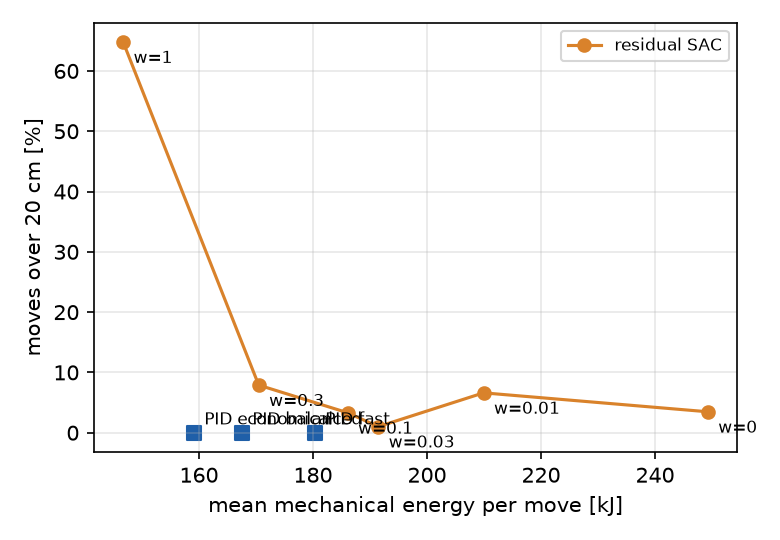

# Lab 12d: energy-weight sweep of residual SAC on the real plant

Generated by `python rl/12d_wsweep_eval.py`. No training. Lab 12 protocol: 100 unseen
scenarios x 72 rows, 10 substeps. SAC: mean over 3 seeds of the per-seed means; range in
brackets. Rows broken (over 5 % misses) / degraded (1-5 %) are counted per seed and
averaged; rl/12_eval.md counts them on the seed-mean miss rate instead.
All values ESTIMATED.

check: w = 0.1 equals rl/12_eval.csv sac_residual on 216 rows, largest difference 0

| controller | miss % | rows broken / degraded | E_mech kJ | gap to floor % | reach 20 cm s | never reached |
|---|---:|---:|---:|---:|---:|---:|
| fast PID + fix 2b | 0.00 | 0.0 / 0.0 | 180.3 | 36.0 | 1.19 | 0 |
| balanced PID + fix 2b | 0.00 | 0.0 / 0.0 | 167.5 | 26.4 | 1.46 | 0 |
| economical PID + fix 2b | 0.00 | 0.0 / 0.0 | 159.1 | 20.0 | 1.99 | 0 |
| residual SAC, w = 0 | 3.47 (1.58-5.07) | 16.0 / 45.3 | 249.3 | 88.1 | 1.11 | 0 |
| residual SAC, w = 0.01 | 6.61 (0.10-13.22) | 39.0 / 11.0 | 209.9 | 58.4 | 1.17 | 192 |
| residual SAC, w = 0.03 | 1.01 (0.67-1.18) | 1.3 / 35.3 | 191.5 | 44.5 | 1.25 | 0 |
| residual SAC, w = 0.1 | 3.31 (1.60-4.72) | 6.3 / 52.7 | 186.1 | 40.4 | 1.46 | 88 |
| residual SAC, w = 0.3 | 7.89 (5.62-12.06) | 45.0 / 27.0 | 170.5 | 28.6 | 2.08 | 175 |
| residual SAC, w = 1 | 64.80 (56.24-75.01) | 72.0 / 0.0 | 146.7 | 10.7 | 4.35 | 12057 |

