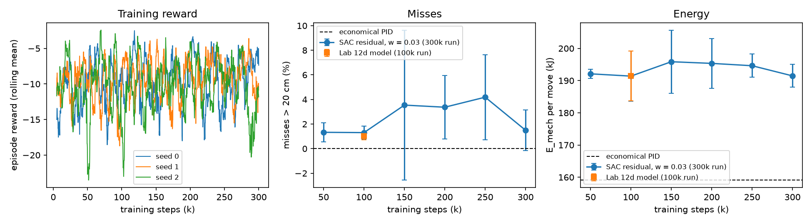

# Lab 12h: longer SAC training (residual on balanced, w = 0.03)

Generated by `python rl/12h_long_eval.py` from the checkpoints of
`python rl/12h_long_train.py` (3 seeds, 300k steps, checkpoint every 50k). Lab 12
protocol: 72 rows x 100 scenarios (new100), 10 substeps.
SAC: mean +- std over seeds. The 100k row of the 300k run and the Lab 12d model (one
100k run) differ only by run-to-run randomness. All values ESTIMATED.

| controller | steps | miss > 20 cm % | mean cm | p95 cm | E_mech kJ | E_pump kJ | beats PID on both |
|---|---:|---:|---:|---:|---:|---:|---|
| economical PID | - | 0.00 | 2.1 | 6.4 | 159.1 | 126.5 | - |
| SAC 300k run | 50k | 1.33 +- 0.79 | 6.1 +- 1.0 | 14.8 +- 1.2 | 192.1 +- 1.4 | 150.8 +- 1.8 | no |
| SAC 300k run | 100k | 1.31 +- 0.53 | 5.8 +- 1.0 | 16.3 +- 1.9 | 191.4 +- 7.8 | 150.9 +- 6.5 | no |
| SAC 300k run | 150k | 3.54 +- 6.10 | 6.3 +- 3.2 | 14.6 +- 6.2 | 195.9 +- 9.8 | 154.3 +- 6.7 | no |
| SAC 300k run | 200k | 3.37 +- 2.57 | 6.7 +- 0.4 | 17.7 +- 3.8 | 195.3 +- 7.7 | 153.0 +- 5.2 | no |
| SAC 300k run | 250k | 4.19 +- 3.46 | 6.5 +- 0.5 | 19.4 +- 4.9 | 194.6 +- 3.6 | 153.0 +- 2.5 | no |
| SAC 300k run | 300k | 1.50 +- 1.67 | 6.6 +- 1.3 | 16.6 +- 1.9 | 191.5 +- 3.5 | 149.7 +- 2.8 | no |
| Lab 12d model | 100k | 1.01 +- 0.30 | 5.7 +- 1.0 | 15.8 +- 1.8 | 191.5 +- 7.7 | 150.9 +- 6.4 | no |

From 100k to 300k steps: misses 1.31 -> 1.50 %, mean error 5.8 -> 6.6 cm, E_mech 191.4 -> 191.5 kJ.

Training time per seed (h): seed 0: 0.72, seed 1: 0.72, seed 2: 0.72.

